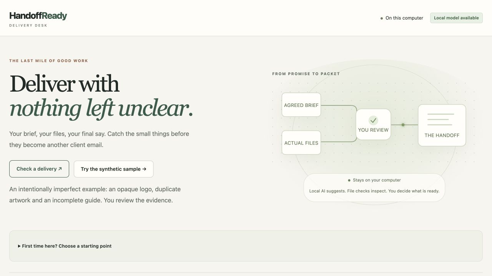
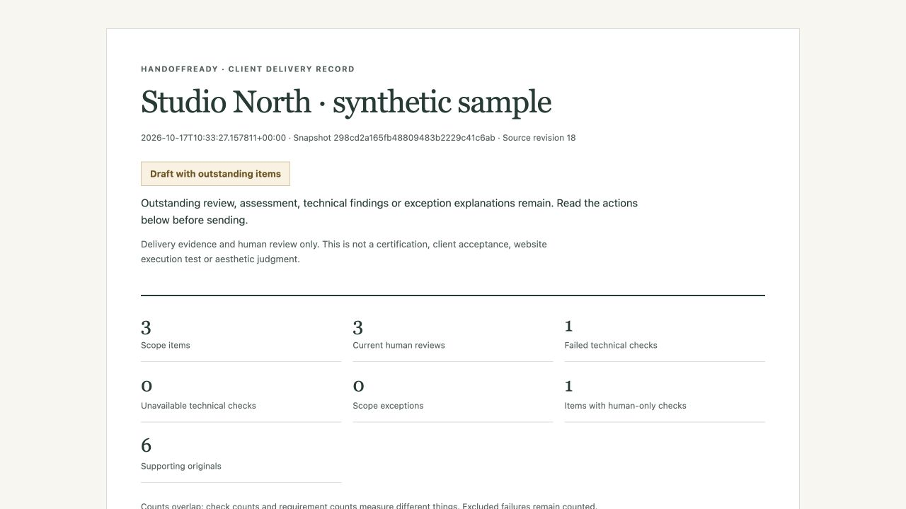

# HandoffReady

**Check the handoff before sending it to the client.** HandoffReady is a local delivery review desk for web and design freelancers. Connect an agreed brief to the actual outgoing files, find narrow technical problems, record your judgment, and prepare a clear client delivery record.

The useful loop is **brief → confirmed scope → imperfect packet → correction → fresh review → new record**. The previous record stays unchanged. Gemma suggests scope and evidence; it never approves delivery.

## Current status

The [18 October critical audit](docs/FINAL-CRITICAL-AUDIT-OCT18.md) found and fixed two concrete problems: a second documented server launch could recover another live process's data folder, and Save and next could cycle between already-reviewed items needing work. The supported launcher now refuses a second owner of the same folder, and the review queue finishes unreviewed items before opening the draft handoff. Current verification passes **254 backend and 75 interface tests**; [audit evidence](docs/audit-oct18-checks.json) records the scope and remaining limitations.

The [17 October submission candidate](docs/RELEASE-OCT17.md) includes the redesigned delivery desk, guided resume, saved-review summaries, searchable evidence and safer replacement recovery. [Current checks](docs/release-oct17-checks.json) passed **250 backend and 74 interface tests**, type checking, production build, formatting and focused static checks. Actual local Gemma extraction/matching and manual workflows also passed synthetic smoke checks. These are not customer trials or general AI accuracy results.

[Watch the current 90-second walkthrough](https://yashanand69.github.io/handoffready/) · [Inspect recorded findings](https://yashanand69.github.io/handoffready/explore/) · [Read the synthetic client record](https://yashanand69.github.io/handoffready/records/after.html)



[Download the source and built interface](https://github.com/YashAnand69/handoffready/releases/tag/v0.2.1). The archive still needs Python dependencies and optional model setup. The older v0.2.0 archive predates the two audit fixes.

The public page plays an edited sequence of actual current UI captures. It runs no hosted inference and takes no uploads. The materials and operator decisions are synthetic. A genuine freelancer trial remains pending. The explorer preserves an explicitly dated earlier recording of the same review contracts; its older screen captures are not the final interface. See [current submission status](docs/SUBMISSION-STATUS-CURRENT.md).



## A delivery desk, five steps

1. **Brief:** save an English text brief. Gemma can propose exact-source requirements; explained manual additions also work.
2. **Scope:** correct the suggestions and explicitly confirm the checklist. Repeated text has separate validated occurrences.
3. **Files:** inspect bounded PNG, JPEG, SVG metadata, native readable PDF, TXT and Markdown originals.
4. **Review:** choose supporting files, inspect facts and record your assessment. Previewing another selection does not save or approve it. Private reasoning and deliberate public notes are separate.
5. **Record:** preview and export immutable JSON, Markdown or print-ready HTML. Send the original files alongside the record.

Human assessment, review currency and technical facts are independent. A human “satisfied” decision cannot erase a failed check. An explicit reviewer exclusion retains its findings and needs a separate client-facing explanation. The record can be **draft with outstanding items**, **reviewed with scope exceptions**, or **reviewed delivery record**; none means client acceptance.

Changed brief, scope or packet inputs invalidate previous mapping reviews. An unchanged filename save preserves them. Different hashes do not prove different designs; transparency metadata does not establish correct background removal. The app does not execute websites, visually certify designs, handle payment or send files to clients.

## Run locally

The validated platform is an **Apple Silicon Mac**. Source setup needs Python 3.12 and Node.js 22.12+ or 24+. Allow approximately 8 GB free disk for model/build artifacts. macOS command-line build tools and CMake are needed when compiling the pinned model runtime. Windows, Linux and physical mobile operation have not been validated.

```sh
python3.12 -m venv .venv
.venv/bin/python -m pip install -r requirements-backend.lock
npm ci --prefix frontend
npm run build --prefix frontend
.venv/bin/python scripts/start.py
```

Open http://127.0.0.1:8877/. **Try the synthetic sample** gives you an intentionally imperfect packet. The launcher without `--with-model` supports manual scope, file inspection, review and export. Model actions show when inference is unavailable.

A reviewed release archive may already contain `frontend/dist/`; source checkouts require the frontend build above. Python and its locked dependencies are still required. The historical v0.1.0 archive does not contain these new upgrades.

### Install Gemma explicitly

```sh
.venv/bin/python scripts/prepare_model.py --help
.venv/bin/python -m pip install --target .runtime/build-tools cmake==4.1.2
.venv/bin/python scripts/prepare_model.py
.venv/bin/python scripts/start.py --with-model
```

The installer downloads and verifies pinned Gemma 4 E2B quantized weights and llama.cpp sources/runtime. It stores them in ignored `.model/` and `.runtime/` directories. llama.cpp runs Gemma; no separate Llama model is required. Downloads need internet. Supported use is local afterward. The launcher does not silently install software, purchase services or accept agreements. Model/runtime licenses are separate from the project's MIT license; see [third-party notices](THIRD-PARTY-NOTICES.md).

The Mac **Start HandoffReady.command** launcher uses the installed model and default ports. Keep its window open while using the app. App/model defaults are **8877 / 18081**. For a separate local session, use different ports and a dedicated data directory:

```sh
.venv/bin/python scripts/start.py --with-model --port 8879 --model-port 18082 --data-dir /path/to/separate-local-data
```

Both services remain loopback-only. The launcher checks occupied ports and does not replace their owners. Use one backend process per data directory; multiple workers are unsupported.

Start the server through `scripts/start.py` or `scripts/run.py`: they acquire an OS lock on the data folder before recovery or cleanup. Changing ports does not permit sharing a folder. A second launcher exits with an explanation; stopping or crashing the owner releases its lock. Directly embedding `create_app()` bypasses this launcher guard and is unsupported for concurrent shared storage.

## Privacy and supported scope

Data defaults to `~/Library/Application Support/HandoffReady`, with owner-only permissions. Use `--data-dir` or `HANDOFFREADY_DATA` for a dedicated local directory. The app does not encrypt storage; device protections still matter. Use synthetic or authorized non-confidential materials for demonstrations.

Client records omit raw briefs, source quotes, raw file text, model explanations and private review notes. **Titles, check descriptions and deliberate client notes are shared**: review their wording before sending. Records identify selected supporting originals, not every uploaded file, and do not embed original bytes.

Private API reads require a session token; writes check Origin and revision. Parsing uses bounded subprocesses. These are local controls, not a hardened operating-system sandbox or protection from same-user malware. No remote AI API, account, payment service or telemetry is required.

| Supported boundary | Limit |
| --- | --- |
| Projects / scope items | 10 projects; 20 requirements per project |
| Delivery packet | 30 files; 50 MiB total; 10 MiB per file |
| Images | 10 million pixels; single frame |
| PDFs | 10 pages; native readable text |
| Brief | 20,000 characters |

ZIP, PSD, Office files, OCR/scanned or encrypted PDFs, animated images and live website execution are outside this release. Larger inputs fail explicitly. Model interpretation can be wrong: inspect every scope proposal and content association.

## Verify and contribute

```sh
PYTHONPATH=backend .venv/bin/python -m pytest -q
npm test --prefix frontend
npm run build --prefix frontend
npm run format:check --prefix frontend
npm audit --prefix frontend
```

API/model doubles test workflow invariants; they do not measure real Gemma accuracy. The frozen fresh synthetic evaluation has a separate [V4 protocol](docs/EVALUATION-PROTOCOL-V4.md) and [first-run analysis](docs/MODEL-EVIDENCE-UPGRADE.md). On ten authored packets, captured Gemma output found 19 correct and two wrong support pairs; the existing format guard retained the 19 correct pairs and removed the two wrong-format pairs. Extraction covered 15/21 mandatory obligations under the frozen definition. These separate-task results are not end-to-end accuracy: the actual app still suggested an irrelevant welcome guide, which remains recorded. No general accuracy, customer benefit or prompt-injection immunity is claimed.

The historical [earlier upgrade checkpoint](docs/upgrade-release-checks.json) passed **239 Python tests and 54 interface tests**, strict TypeScript/production build, frontend formatting and focused Ruff `F,E9`; `npm audit` reported zero vulnerabilities. The known Starlette/httpx test-client deprecation warning remains. The independent persisted-null baseline no-op repair and its regressions are included in this result. These local results are not a new remote CI run. A [fresh-dependency clean manual workflow](docs/workflow-verification-clean-manual-final.json) passed all seven scripted synthetic stages without model inference.

Read [CONTRIBUTING.md](CONTRIBUTING.md) before changing the app. The [documentation index](docs/README.md) distinguishes current upgrade evidence from the historical release and original plans.

Human product direction selected the audience, free/local constraints and full delivery workflow. AI agents implemented and evaluated the application and operated the synthetic demonstration. End-user approval and client-facing wording remain explicit reviewer decisions. Customer outcomes, revenue and contest placement have not been established.

Recorded-explorer provenance checks require the recorded base commit in Git history. Run the full verification suite from a full repository clone; a source ZIP can run the app but does not contain Git history for rebuilding that historical evidence.
