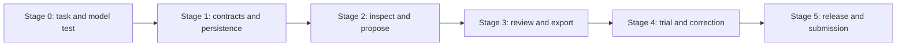

# Staged implementation plan

> Historical planning specification, preserved from 13 October 2026. Current implementation, verified departures and release limits are recorded in [STAGE-REVIEWS.md](STAGE-REVIEWS.md), [BUILD-CONTRACT.md](BUILD-CONTRACT.md) and [FULL-STACK-RELEASE.md](FULL-STACK-RELEASE.md). A proposed benchmark or trial below is not evidence that it occurred.

Version 1.0 • 13 October 2026 • New project not yet implemented. Dates are proposed delivery targets; no automatic jobs are scheduled by this document. Estimates are planning allowances, not guaranteed completion times.

## Strategy and critical path

**Evidence first → reliable vertical slice → real user → focused polish → tested submission.** The scope is one customer's delivery-preparation task. Mandatory core is a genuinely executed open model plus the deterministic artifact checks and review/export workflow. A synthetic fixture proves mechanics; it does not prove demand or measured business value.

A customer trial can begin once the slice works; synthetic development can proceed while waiting for authorized material. Missing feedback prevents customer/savings claims, not independent implementation. The parent owns integration and gates; UI/backend/model agents own bounded modules. Independent review is assigned after each milestone. Maximum four concurrent agents including parent.

## Stage 0 — feasibility and build contract

**Target: 13 October. Planning allowance: 4–6 focused hours.**

- Start a fresh repo when implementation is authorized. Add README, .gitignore, dependency/model manifest and synthetic fixture provenance; exclude private data/models/secrets.
- Ask the reachable web/design freelancer about their latest handoff problem using the trial protocol. Inspect only consented/redacted inputs. Do not contact them automatically.
- Build a small labeled fixture corpus, including ambiguous names, valid manual requirements, quantities, duplicate content and misleading filenames.
- Run Gemma 4 E2B and one Qwen3-4B alternative through a pinned local runtime on identical extraction/mapping tasks. Record actual outputs, revisions, cold/warm latency, memory and correction burden. No model install/benchmark has happened during planning.
- Choose one parser stack and supported input limits from TRD. Verify exact licenses and installability. Finalize shared data/API vocabulary before parallel coding.

**Gate G0:** actual open inference works on this Mac; source-validation rejects invented quotes; manual/rule baseline is recorded; chosen model has enough task value to justify AI-core positioning. If Gemma fails, evaluate the alternative and drop its category rather than fake results. If neither passes, narrow the task and retry once; do not build a decorative AI claim around manual rules. Native PDF support may be cut if parsing is unreliable; retain text/Markdown and image checks.

**Review:** product and model reports cross-reviewed by parent plus an agent who did not tune the prompts. Customer problem remains a hypothesis until trial evidence arrives.

## Stage 1 — project, source and baseline vertical slice

**Target: 14 October morning. Allowance: 4–6 hours.**

Backend: private storage, schema migrations, immutable source text/spans/hash, project revision checks, request validation, explicit errors and local host/origin/token protections. UI: new/open project, pasted brief, recoverable draft, model readiness and candidate checklist. Model adapter: bounded extraction job and exact evidence validation.

Freeze model suggestions into a reviewable candidate set; user corrections produce a versioned confirmed baseline. Manual items have explicit provenance. Saving/reloading preserves state. Editing an approved baseline invalidates old comparisons.

**Gate G1:** brief → real model → quoted candidates → correction → approved baseline → reload works via browser/API/database. No invented candidates when inference is unavailable. Tests cover Unicode spans, source replacement, optimistic conflict and stale result rejection.

**Review:** API/storage agent's changes reviewed by model or QA agent; UI focus/state reviewed independently; parent checks complete flow.

## Stage 2 — bounded files and artifact matching

**Target: 14 October afternoon–15 October morning. Allowance: 6–8 hours.**

File worker implements safe PNG/JPEG, SVG metadata, native-text PDF and text/Markdown inspection with caps/timeouts; raw SVG/HTML is never executed. Actual file content is hashed. Shared names do not overwrite bytes. Inspection errors remain unknown/rejected, not successful absence. Packet storage stays outside repo.

Model worker maps confirmed requirements to inspected metadata/text, validating source IDs/quotes and leaving ambiguity unresolved. Numeric/format rules remain deterministic. UI file list and evidence panel show both inspected facts and proposed relationships. Changed artifacts invalidate prior checks and decisions. No archive import or automatic web crawling.

**Gate G2:** a deliberately defective packet produces the expected bounded findings; duplicate content cannot silently satisfy a distinct-asset count; nonopaque-pixel detection is accurately described; filename alone cannot verify documentation content. Parse failures, unsupported requirements and model errors preserve manual recovery. Memory/cancellation tests pass.

**Review:** file inspector adversarial review by a non-author; model proposals inspected against recorded inputs; parent reviews concurrency/snapshot handling.

## Stage 3 — correction, persistence and truthful export

**Target: 15 October. Allowance: 6–8 hours.**

Implement independent mapping/check/human states, final-artifact selection, rejection/correction history and reasoned exceptions. Bind decisions to baseline + file + parser/check revisions; reject stale saves. Durable jobs recover as interrupted on restart, cancellation cannot commit late results. Persist edits or guard unsaved navigation.

Export a snapshot-consistent Markdown/JSON/print-ready manifest. Preview client-visible content and unresolved items. Exclude internal messages/prompts/original bytes by default. No global contract-complete score. Include manifest integrity metadata. P0 restart/reload recovery precedes private-backup convenience.

**Gate G3:** full brief → packet → real suggestions → corrected review → export → reload/revisit flow works. Changed file/baseline invalidates prior decisions and prevents stale export. Export escaping, privacy, restart/cancel and disk-error tests pass. First useful output can be produced without optional integrations.

**Review:** an independent reviewer traces exports back to actual source/current hashes; parent performs end-to-end task from a clean fixture.

## Stage 4 — user trial, held-out evaluation and UI refinement

**Target: 16–17 October. Allowance: 6–10 hours plus tester availability.**

Run consented task trial per [original 06-USER-VALIDATION.md](planning/06-USER-VALIDATION.md). Use comparable tasks/counterbalanced order to reduce familiarity effects; record setup/review time, false alarms, missed defects and corrections. If one repeated task is all available, report the confound. Ask if they'd use the tool on the next real project and what a useful paid offer would contain; answers are not purchases.

Run model held-out evaluation after prompt freeze. Measure semantic contribution separately from parser/rule correctness and output schema validity. Evaluate misleading source instructions and ambiguous matching. Resolve important defects before UI polish.

Refine the working desk: source beside decision, keyboard/screen-reader status, 390/768/1280px and zoom/reflow, no dependency on motion, fast direct entry. Capture an actual inference video. Do not reroute development into a hero/3D animation project.

**Gate G4:** no open P0 or release-blocking P1 correctness/data-loss/security defect; benchmark findings include failures and denominator; client output is understandable; notes and telemetry remain private unless consented. A real user is desirable but optional for entry; if unavailable, delete the first-user section and state that business value remains unvalidated.

**Review:** QA agent examines findings; parent independently verifies fixes and the full current diff.

## Stage 5 — release, documentation and submission package

**Target: 18 October; buffer until 19 October 12:29 p.m. IST. Allowance: 4–6 hours.**

Run required checks once on the final candidate, extending only after changes/failures. Freeze/tag SHA, test clean setup/readiness, verify no private assets/secrets/model binaries in Git. Confirm dependency notices and public fixture provenance. Publish public sample only within authorized deployment scope; actual local inference video must match release behavior.

Prepare official-template article: real problem, flow, original code/reused foundations, model limitations, openness, economics and user evidence if available. Verify code/demo links and actual category use. No second Week 2 entry. Ask any required final publication/rule acceptance only after post/demo is concrete and reviewable.

**Gate G5:** release checklist satisfied, correct repo/tag/demo/article, honest claims, consent/license evidence, deadline margin. Later commits dated separately in README. DEV/MLH sticker syncing is tracked separately from publication receipt.

## Parallel ownership and integration discipline

| Phase | Parent | Worker A | Worker B | Worker C |
|---|---|---|---|---|
| Feasibility | Decisions, repo/manifest | User task + corpus | Model benchmark | Parser/license feasibility |
| Core build | Integrates shared contract | API/storage/jobs | UI/workflow | Inspectors/model adapter |
| Validation | Full flow, claims | Independent code review | UI verification/fixes | Held-out eval/trial documentation |
| Release | Final decisions/publish scope | Clean setup + QA | Demo/write-up | License/privacy audit |

Workers do not edit the same module simultaneously. Use branch contributions to the fresh repo during build, small coherent commits, agreed interfaces and explicit handoff notes. Parent checks full diffs and performed test results before integration. Reviewers identify evidence and severity; authors fix confirmed defects; reviewers verify. Passing tests never authorizes claims of zero defects.

## Scope cuts if time slips

Cut in this order: visual extras, custom themes, embedding retrieval, native PDF brief import, private ZIP restore, expanded formats, second-model UI selector. Keep actual AI inference, evidence validation, baseline approval, PNG/JPEG + text/Markdown workflow, hash invalidation, safe persistence, export and honest error states. Native delivery PDF can be removed if parser gate fails and unsupported status is explicit. Never replace actual inference with canned output while claiming live AI.

If the remaining time cannot satisfy G3/G4/G5, ship a narrower truthful project or report the blocker. Do not invent trial results, split claims from actual functionality, or publish untested features to reach the deadline.

## Completion definition

A reviewer can install/run the exact release, reproduce the example defect, understand the open model's contribution and limits, correct a suggestion, export a handoff, reopen saved work, and verify that changed evidence invalidates prior decisions. The code, demo and write-up tell the same story. User validation and commercial demand are separately documented, never implied by a test count.
