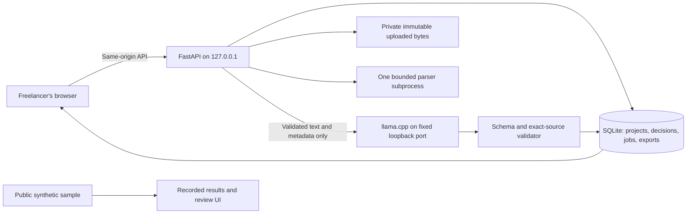

# HandoffReady — Technical Requirements Document

> Historical planning specification, preserved from 13 October 2026. Current implementation, verified departures and release limits are recorded in [STAGE-REVIEWS.md](STAGE-REVIEWS.md), [BUILD-CONTRACT.md](BUILD-CONTRACT.md) and [FULL-STACK-RELEASE.md](FULL-STACK-RELEASE.md). A proposed benchmark or trial below is not evidence that it occurred.

Version 0.1 · 13 October 2026 · Planning only. This is an engineering design, not an implementation, benchmark, security certification or promise of flawless behavior. [original 01-PRD.md](planning/01-PRD.md) defines the customer job; [original 03-DATA-API.md](planning/03-DATA-API.md) defines the contract. All limits and latency budgets below are proposed release requirements, to be tested before shipping.

## 1. Architecture decision and feasibility

Build a fresh original repository. Use React + TypeScript + Vite for the interface, FastAPI/Pydantic for the loopback API, Python's SQLite integration for private persistence, Pillow for PNG/JPEG inspection, pypdf for native PDF text, and defusedxml for SVG metadata. Serve the production interface from the same FastAPI origin. Use a separately supervised, pinned llama.cpp server for local text inference. Trial the official Gemma 4 E2B instruction Q4 artifact; compare with a pinned Qwen3-4B artifact. Keep one model loaded at a time. Actual quality, memory and latency are unknown until Stage 0.

This design intentionally uses one PDF extraction path. Docling, PDF.js parsing in parallel, OCR models and general agent frameworks are unnecessary for the first delivery checker. Changing the parser later creates a new extraction revision and invalidates dependent evidence. pypdf documents that content streams can consume considerable memory and that extracted layout/text can be ambiguous; hence process-level budgets and human source review are requirements. [pypdf extraction documentation](https://pypdf.readthedocs.io/en/stable/user/extract-text.html).

The model cannot execute tools, fetch URLs, write files, send messages, decide client acceptance or approve a checklist. The public sample has no connection to local or hosted inference. It presents explicitly labeled recorded runs on publishable fixtures. The local app is the actual arbitrary-input AI workflow, with a reproducible setup and real-run video.

## 2. P0 boundary

**Supported:** pasted English brief, human-approved requirements, user-selected delivery PNG/JPEG/SVG/PDF/TXT/Markdown files, literal text evidence, bounded metadata checks, model match proposals, human decisions, persistent reload, cancellation/recovery, immutable Markdown/JSON/print-HTML handoff export.

**Not in P0:** PDF brief import, OCR/scans, Office/PSD/AI/Figma imports, ZIP imports, recursive filesystem crawling, remote URLs, website/repository execution or audits, logo appearance quality, live integration/account sync, billing, shared cloud storage, automatic client sending, backup restore, local-model installation bundled inside the app. P1 PDF brief import must use the same validated parser and bounded source representation; it must not delay the pasted-brief flow. Unsupported delivery files may be listed as unsupported evidence, but never inspected or counted as a satisfied typed deliverable.

The promise is delivery evidence against a confirmed checklist. It cannot prove that a live website works or a design meets aesthetic expectations.

## 3. Canonical limits

These constants must live in one backend policy module, be returned by capabilities, and be mirrored by boundary tests. Frontend checks improve feedback; the server remains authoritative.

| Resource | Fixed P0 limit and handling |
|---|---|
| Active packet | 30 selected delivery files; 50 MiB original bytes combined; 10 MiB/file; streamed upload, never whole-body unbounded buffering |
| Brief | 20,000 Unicode code points after newline canonicalization; nonempty; English-first; no silent clipping |
| Requirements | 20 approved requirements; title 160 code points; rationale/decision note 2,000; quote 500 |
| Images | PNG/JPEG only; 10,000,000 decoded pixels; neither side >10,000 pixels; exactly one frame; truncated or undecodable files blocked |
| PDF | 10 pages; encrypted/password files blocked; no OCR; any page beyond limit blocks the file rather than treating a partial extraction as complete |
| TXT/MD/SVG | 1 MiB/file; strict UTF-8, reject undecodable input; SVG metadata only |
| Extracted delivery text | 20,000 code points/file and 100,000 across active packet; exceeding budget produces an explicit blocked extraction; no invisible truncation |
| Parser execution | One subprocess at a time; 20 seconds/PDF, 5 seconds/image, 3 seconds/TXT/MD/SVG; 120 seconds per inspection job total |
| Parser memory | Parent monitors worker RSS every 100 ms; terminate at 512 MiB; process limits where supported; no claim of hard isolation against every native exploit |
| PDF decoded content | 5 MiB/page and 20 MiB/file once decoded, bounded by subprocess time/RSS while decoding; reject over-budget streams |
| Model context | 8,192-token server context; request budget ≤6,000 input tokens including system/schema and ≤1,500 output tokens, leaving safety margin; tokenizer-counted, no silent truncation |
| Model job | One inference request at a time; ≤60 seconds/request; ≤120 seconds for an extraction or matching job; maximum one structural repair call inside that same budget |
| Storage | 1 GiB application-original-byte quota and 10 active projects; enforce before commit; SQLite/text/export overhead monitored separately; delete is available |
| Export | ≤2 MiB generated text per format; selected immutable snapshot; no delivery assets embedded/repacked |

A model matching job may be incomplete under the fixed time/context budget. It must return explicit per-requirement `not_proposed` reasons, not infer completeness from the portion processed. Never feed the whole 100,000-code-point packet to the model. Construct bounded batches of metadata and paragraph snippets with stable source IDs. If request input exceeds the token budget, split deterministically and record coverage, or stop with `context_limit`. Stage 0 determines the feasible batch size and number of requirements; lower release scope openly if these bounds cannot support acceptable interaction.

## 4. Ingestion and deterministic inspection

1. Browser file selection provides bytes only. No client-supplied absolute filesystem path is read. Use a server-generated file ID and private storage name; retain a sanitized display name separately.
2. Stream to a private temporary file while enforcing byte and application quotas. Compute SHA-256 on bytes. Normalize display name controls; never interpolate it into shell commands, paths or HTML.
3. Determine supported type from actual signatures/parser identification, then compare with extension. A JPEG named `.png` is flagged as an extension mismatch and is not a valid PNG deliverable. Text has no reliable unique magic number; label it UTF-8 text based on validated decoding, with declared `.txt`/`.md` type and no executable interpretation.
4. Store immutable bytes. Inspection is asynchronous, sandboxed as far as the operating system/process boundary permits. Never execute a supplied file or shell command. Parser jobs do not initiate network requests.
5. Preserve all safe results and explicit errors. A failed parser is `blocked`, not an absent file or a successful empty document. Zero extracted text is `unknown` for content requirements; scanned PDFs are unsupported.
6. Duplicate raw hashes identify exact byte duplicates. Renamed byte duplicates cannot satisfy an explicitly distinct-file count twice. Different hashes do not establish distinct visual designs. Count semantics are typed and confirmed by the user; acceptable repeated copies remain possible when the brief calls for them.

Pillow's lazy identification is not sufficient validation. Verify then reopen and decode within budgets; turn decompression warnings into errors. For PNG transparency, inspect the decoded RGBA alpha range, including palette/`tRNS` conversion: `min(alpha) < 255` establishes at least one nonopaque pixel. An RGBA file with alpha 255 everywhere fails that narrow test. A single translucent pixel does not establish correct background removal; preserve that manual check. Exact dimensions refer to encoded pixel width/height, not screen scaling or EXIF-oriented display. [Pillow identification and decompression safeguards](https://pillow.readthedocs.io/en/stable/reference/Image.html).

SVG is parsed using defusedxml with DTD/entity processing forbidden. Read root dimensions/viewBox only. Do not embed raw SVG, resolve external resources or render it; show a generic file icon and escaped metadata. Percentages/relative units or complex geometry make pixel-dimension equivalence `unknown`. Any display later needs a separate safe rasterization design. [defusedxml threat model and limitations](https://github.com/tiran/defusedxml).

## 5. Requirement extraction and source integrity

A brief produces **suggestions**, never an approved baseline. Each suggested requirement includes a literal source quote and a typed proposed check or `manual`. The server verifies source existence and a literal unique occurrence of the quote in the immutable extracted source unit. The model does not decide offsets; the validator derives them. A repeated/ambiguous quote is flagged for human source selection. Invalid quotes are rejected visibly and cannot enter the approval flow as valid citations.

Canonical text is strict UTF-8 decoded to Unicode, with CRLF/CR converted once to LF, no NFC/NFKC rewriting and no HTML interpretation. Hash the canonical UTF-8 bytes. Offsets are **Unicode code-point indices**, end-exclusive, against exactly the displayed immutable text. Python slices naturally use this convention; JavaScript uses `Array.from(text)` when slicing/highlighting rather than UTF-16 string indices. Test emoji, combining marks, ligatures, tabs and repeated text. PDF page source units retain page number, extractor version and original file hash; quotes are exact within that representation, not claims about the PDF's visual reading order.

A user can correct titles/check parameters and add a requirement manually. A manual addition with no source span must be marked `human_added`, with an explanatory note; it cannot be presented as a model-extracted contractual clause. Approve the baseline only after review of all included rows and count interpretation. Rejected suggestions remain in the local audit trail. Ambiguous/contradictory brief statements require a human decision; no automatic conflict resolution.

Allowed check families: supported file presence/type, file count with explicit `exact` or `at_least` comparator and confirmed distinct-byte semantics, encoded image dimensions, PNG nonopaque pixels, PDF page count with `exact` or `at_least` comparator, exact literal text, and manual verification. Parameters are integers/booleans/enums with strict bounds and explicit units. Model-generated check parameters require human confirmation. “Guide explains how to update contact details” is a semantic/manual judgment; a quoted paragraph can help review but is not a deterministic completeness test.

## 6. Matching, status and approval invariants

Maintain separate facts, model proposals and human judgments:

| Axis | Values | Meaning |
|---|---|---|
| Baseline | `draft`, `approved`, `stale` | Whether this specific requirement revision is confirmed |
| File inspection | `queued`, `running`, `inspected`, `blocked` | Technical inspection outcome, independent of delivery presence |
| Check | `pass`, `fail`, `unknown`, `not_applicable` | Narrow deterministic result, with reason and evidence |
| Proposal review | `unreviewed`, `confirmed`, `rejected`, `stale` | Human disposition of proposed file/content mapping |
| Human disposition | `unresolved`, `satisfied`, `needs_work`, `not_applicable` | Human assessment, with source-linked notes and explicit responsibility |
| Job | `queued`, `running`, `succeeded`, `failed`, `cancelled`, `interrupted`, `superseded` | Durable execution state |

No overall confidence/quality percentage. A check can pass while the requirement remains unresolved. A human `not_applicable` note does not rewrite a failed technical check as a pass. Export shows both the actual check and the disposition. “Ready to prepare handoff” requires an approved current baseline, confirmed current mappings where needed, and reviewed dispositions for every requirement. It is a workflow label, not certification, client acceptance or legal compliance. Unresolved export is allowed only with explicit acknowledgment and prominently retained gaps.

Bind proposals, checks and human confirmations to baseline hash + packet hash + extraction/validator/model provenance. P0 uses a deliberately conservative invalidation rule: any active packet mutation makes all current match confirmations/dispositions stale and requires review; the approved brief baseline remains approved. A baseline change creates a new draft and stale prior dependent evidence. Preserve historical records. Inspector/parser version changes also invalidate relevant evidence. Identical bytes alone do not preserve an approval after a renamed/replaced packet mutation because names can affect mappings. Re-running only a model without changing inputs leaves old human decisions intact but presents new suggestions separately; it never silently replaces confirmed selections.

## 7. Persistence, jobs and stale results

SQLite uses foreign keys, WAL, parameterized queries, explicit short transactions and one writer queue; never share an unsafe connection across arbitrary threads. Persist the job before starting work. Parser/model subprocess output is staged outside the transaction, then committed only if the recorded input snapshot is still current. Use optimistic `project.revision` on user mutations and input-hash snapshot comparison on job publication; do not confuse an unrelated revision change with a changed model input. [Python SQLite transactions and binding guidance](https://docs.python.org/3/library/sqlite3.html).

Each job records immutable inputs, stage, timestamps, attempt and cancel flag. On restart, mark former `running` jobs `interrupted`, preserve saved decisions and permit an explicit retry as a new job. No autonomous retry/re-run after reboot. A queued job may resume only with a still-current input snapshot and user-visible status. Cancellation closes the inference connection/kills the app-owned parser worker and prevents any later publication. If the separate model server does not stop generation promptly, report cancellation of the app job accurately; its resource may remain busy until the request ends. Test cancellation and shutdown behavior for the pinned server.

Never apply a late response after a brief edit, file replacement/removal, project deletion or a newer run superseding it. A stale response is `superseded`, with no proposals/checks attached to current state. A reconnect polls saved jobs, not a frontend-owned promise. Failed jobs expose safe actionable reasons; logs omit client text, raw prompts, filenames and local paths by default.

Exports are immutable content blobs created inside a single SQLite transaction from a frozen current snapshot, with a snapshot hash and created timestamp. All three P0 formats use the same safe client projection: approved requirement titles, file/check evidence and explicit human/gap states, without raw brief text, source quotes, internal decision notes, local paths or model prompts. Client usage notes are a separately entered optional field, empty by default and shown in the exact preview; never derive them automatically from private commentary. Render Markdown/JSON/escaped print HTML from that projection; downloadable bytes never depend on subsequently edited project state. The app must not claim a cross-filesystem/DB atomic commit. Uploaded private bytes use temporary write + atomic rename + transactional registration; on startup clean unregistered temporary/orphan files, keeping registered originals. Full encrypted backup and validated restore are P1. P0 save/reload/project delete and export are mandatory.

## 8. Local security and privacy

Default app origin is `http://127.0.0.1:8877`; model origin is `http://127.0.0.1:18081`. Bind both to loopback, never `0.0.0.0`. Reject unexpected Host values (including attacker DNS names); allow only explicitly configured loopback hosts/ports. The shipped production UI and API share one origin; no wildcard CORS. Development origin, if used, is a single exact configured loopback origin with CSRF protections unchanged. FastAPI supports middleware composition; application policy must explicitly verify Host and Origin rather than assume a loopback bind defeats browser attacks. [FastAPI middleware documentation](https://fastapi.tiangolo.com/advanced/middleware/).

Bootstrap a short-lived server-generated session/CSRF token from same-origin UI. Keep mutation tokens in browser memory, not URLs/localStorage; validate them and exact Origin on every write/upload/job/export/delete, reject missing/null/unapproved Origin. Require JSON or explicit multipart on expected endpoints; no GET mutations. Read-sensitive API calls also require the session token; credentials are not a defense against malicious same-origin scripts, so no external JS/analytics/CDNs. Clear tokens on restart and re-bootstrap.

The model endpoint is fixed in trusted local configuration, not supplied by a brief, model output, public UI or project JSON. Accept literal loopback address and an allowed port only; disable proxies, redirects and DNS resolution. Fail closed if the configured endpoint is not the expected loopback service. Model requests contain bounded text/metadata, not original files. Prompt instructions treat all supplied material as untrusted data, but structural/schema/source validation and human decisions are the actual safety boundaries. No execution or broad filesystem tools exist.

Private files live outside the repository under a restricted application-data directory, with owner-only file/directory permissions where supported. Data is not encrypted at rest in P0; recommend OS disk encryption and prohibit confidentiality guarantees. No telemetry/cloud uploads. UI explains model download is an explicit setup-time external connection; inference stays local after setup. Delete removes project records, originals and associated exports under a documented purge routine; SQLite/WAL/free blocks and system backups may retain recoverable traces. Do not describe deletion as forensic erasure. Private client fixtures never enter Git, public examples, recordings or agent-session publication without separate permission/redaction review.

## 9. Model adapter and release evidence

Record exact model repository/revision/artifact SHA-256/weight license, llama.cpp commit/build flags, chat template, tokenizer identity, generation parameters, prompt/schema version and input/output hashes. Validate structured JSON with Pydantic and evidence against existing source IDs. No automatic fallback to fabricated rule results. If the selected model fails, UI shows `model_unavailable` or the actual failure and permits explicitly labeled manual workflow. Switching to a evaluated Qwen model is a user-visible configuration change with new provenance, not a hidden Gemma success. Structured response controls constrain shape, not truth. [llama.cpp server documentation](https://github.com/ggml-org/llama.cpp/blob/master/tools/server/README.md).

At Stage 0, freeze installed dependency versions and hashes in Python/frontend lockfiles and a model/runtime manifest. Current documentation versions are research references, not a verified compatible lock. No `latest` runtime/model download in release setup. Require selected model license and exact notice review before packaging. New model/runtime versions require re-evaluation.

The release gate requires: cold and warm real local runs, honest memory/latency measurements, schema/source validation, ambiguous and missing evidence cases, unchanged-vs-changed file invalidation, restart/cancel/stale behavior, malicious input/parser boundary tests, browser workflow through export, and a held-out/user comparison described in [original 05-QA-EVALUATION.md](planning/05-QA-EVALUATION.md). If AI produces unacceptable unsupported matches or install friction, narrow the scope early. Do not postpone the model proof until after UI polish.

## 10. Implementation order and cut rules

1. **Stage 0:** freeze schema/caps, one safe parser probe, two real model baselines, explicit hardware/setup measurements and first-user workflow check.
2. **Stage 1:** project persistence, pasted source, exact evidence and baseline approval.
3. **Stage 2:** upload/inspection, bounded AI proposal jobs, human matching, checks and invalidation.
4. **Stage 3:** review UX, immutable exports, restart/cancel/conflict behavior.
5. **Stage 4:** real-user test, security/accessibility checks and measured fixes.
6. **Stage 5:** public recorded sample, tested release and truthful submission story.

Cut OCR, broad file support, account systems, asset repackaging and paid integrations first. Cut cosmetic motion before evidence integrity, save/reload, deletion, meaningful AI or export. Native PDF extraction may be cut to TXT/Markdown if its gate fails, with support claims visibly amended. No phase may be called complete solely because its UI looks finished.
