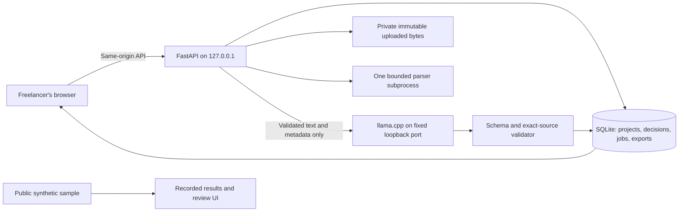
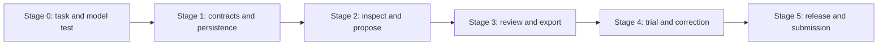

# HandoffReady — complete implementation dossier

Prepared 13 October 2026. Planning specifications and synthetic UI only; no completed application or benchmarks are claimed. Individual files are the canonical editable documents.


---

# HandoffReady implementation package

Prepared 13 October 2026 (Asia/Kolkata). **Planning complete; application implementation has not begun in this package.** Three subagents drafted product/validation, technical/contracts and QA/release; parent integrated UI, essentials, submission strategy and staged delivery. Cross-review findings and fixes are recorded in [the planning review](11-PLAN-REVIEW.md).

## Product in one sentence

An original private delivery desk that maps a freelancer's confirmed brief to their actual web/design delivery files, checks supported technical properties, keeps AI suggestions reviewable, and exports an honest client handoff.

## Read in this order

| Document | Purpose |
|---|---|
| [Implementation plan](10-IMPLEMENTATION-PLAN.md) | Six stages, dates, owners, gates, critical path and scope cuts |
| [PRD](01-PRD.md) | Customer/job, priorities, 15 functional requirements and acceptance cases |
| [TRD](02-TRD.md) | Architecture, parsers/models, caps, concurrency, local security and provenance |
| [Data/API contract](03-DATA-API.md) | Entities, source spans, states, snapshot guards and endpoint payloads |
| [UI/UX specification](04-UI-UX.md) | Five screens, visual system, responsive/accessibility/motion/error requirements |
| [QA/evaluation](05-QA-EVALUATION.md) | Boundary/adversarial tests, actual-model evaluation and fair baselines |
| [User validation](06-USER-VALIDATION.md) | Interview, authorized input, task trial, pricing hypothesis and evidence |
| [Risk/release](07-RISK-RELEASE.md) | Risk owners, stage reviews, blocking defects, freeze and rollback |
| [Open-source/submission](08-OPEN-SOURCE-SUBMISSION.md) | Licenses, reuse, free budget, categories, demo and article evidence |
| [Essentials/skills](09-ESSENTIALS-SKILLS.md) | Technical skills, toolchain, agent responsibilities and owner inputs |
| [Planning review](11-PLAN-REVIEW.md) | Cross-document corrections, traceability and unverified gates |

[Explore the five-screen design prototype](UI-WIREFRAME.html). It contains only synthetic examples and no inference, file intake or persistence. [Preview image](UI-PREVIEW.png).

## Agreed strategic decisions

- New repository and original workflow built on licensed foundations; no rebrand of an existing app.
- Pasted English brief first. Delivery images/native-text PDF/text/metadata with bounded parsing. Advanced formats and integrations deferred.
- Actual local Gemma benchmark first; Qwen alternative if it performs better. Do not claim Gemma use until it runs in the finished core.
- File facts, AI matches and human decisions are independent. Changed packet/baseline invalidates prior reviews.
- Client-safe manifest default; source conversations, raw quotes and internal rationale remain private.
- Free/local tooling; no paid services or invented account credits.
- Useful workflow and real evidence before visual embellishment. UI is a calm review desk with evidence beside each decision.

## Proposed schedule

13 October: customer/task and model/parser feasibility. 14 October: source/baseline and files. 15 October: review/export/recovery. 16–17 October: trial, held-out evaluation, fixes and UI. 18 October: tested release and submission. Official researched cutoff: **19 October 2026, 12:29 p.m. IST**. Estimates depend on benchmark and tester results; the plan includes cuts and fallback gates.

## Evidence status

Completed: source research, proposed specification, cross-document review, illustrative UI navigation/visual inspection. Pending: implementation, model/parser benchmarks, actual user trial, paid-demand evidence, production testing and submission. No plan can certify a flawless product or guarantee a win.

## Research references

The archive includes these supporting reports beside this folder so relative links remain usable:

- [Decision and competitor examination](../HF-WEEK2-RECOMMENDATION.md)
- [Official rules and free-tier constraints](../HF-WEEK2-RULES.md)
- [Open-source foundations](../HF-WEEK2-FOUNDATIONS.md)
- [Idea/customer research](../HF-WEEK2-IDEAS.md)


---

# HandoffReady — Product requirements document

Version: planning v1 · 13 October 2026 · owner: Yash Anand

**Stage 0: proposed product.** This document specifies behavior to build and validate. It is not evidence of implemented features, model performance, customer demand, a completed user trial, revenue, or contest eligibility certification. The working name is provisional.

## 1. Product decision and purpose

HandoffReady helps a freelance web developer or designer prepare a final delivery package against an agreed brief. The user confirms the requirements, inspects file-backed evidence, resolves discrepancies and exports a clear handoff manifest. A local open model proposes semantic matches; bounded deterministic inspections check supported technical properties; the freelancer owns the final decisions.

The proposed promise is: **“Check the files you are about to deliver, explain what each one satisfies, and carry unresolved items into the handoff.”** The product does not promise to certify a finished website, contract fulfillment, design quality, legal rights, or client acceptance.

This is a new Week 2 product, with original workflow/data logic built on credited licensed dependencies. It is not a renamed Soundwalk Atlas, a fork of a finished handoff service, or a general project manager. The full technical and UI contracts are in this pack's TRD and UI specification.

## 2. Customer, problem and evidence status

### Primary user

A solo web/design freelancer, or a small agency's delivery owner, who sends exports, guides and related files after a project. The user has access to a potential tester doing web development and design. No packet, recurring pain, actual usage or willingness to pay has yet been observed.

### Customer job

“Before I send the final folder, help me find missing/wrong exports and explain the contents so the client can use them without another round of avoidable questions.”

### Proposed buyer

The freelancer/studio owner who bears rework and support costs. The client is the recipient of the resulting manifest, not necessarily a logged-in user. Initial adoption must work without client migration, a team account, or third-party integrations.

### Hypotheses to test

| Hypothesis | Evidence needed | Current status |
|---|---|---|
| Packet omissions or ambiguity recur | Recent concrete delivery example and actual artifact requirements | Unverified |
| The checklist/manifest helps on real work | Observed use, corrections, useful output and next-project intention | Unverified |
| Semantic AI adds value over filename/rules | Same bounded cases evaluated against a simple baseline, including hard negatives | Unverified |
| Privacy/local operation matters | User's own tradeoff between local setup and cloud convenience | Unverified |
| Someone would pay | Tested price response or actual purchase; interest alone is insufficient | Unverified |

The contact need not respond before independent prototyping starts. Synthetic fixtures and parser/model tests are useful immediately. Genuine user validation gates claims of customer usefulness, time savings and demand, not all implementation work.

## 3. Success definition

### Release success

A fresh user can complete one supported task: add a brief, confirm a checklist, inspect selected files, review suggestions with evidence, resolve or retain open issues, and export/reopen a truthful manifest. The normal and failure paths are exercised on a supported machine with the actual selected model.

### Customer success

A consenting tester understands the output and can identify whether it improves their existing process. Record preparation/review time, corrections, missed seeded defects, false flags, useful catches and setup burden. Report findings descriptively; a small convenience sample cannot establish industry-wide savings.

### Open-model success

The model is actually invoked in extraction/matching, adds useful semantic proposals on at least some nontrivial cases, and never bypasses quote validation or human confirmation. If it adds no useful advantage, narrow or revise the product and its contest story before claiming open AI is central. Model/category selection follows the TRD's benchmark gate; Gemma is a candidate, not an already integrated feature.

### Contest delivery target

Freeze a tested release and finish the truthful entry by **18 October evening IST**, ahead of the official **19 October 2026, 12:29 p.m. IST** deadline. Writing and practical paid utility matter; no winning odds or numeric judging weights are assumed. [Week 2 brief](https://dev.to/challenges/hacktoberfest-week2-2026-10-12), [specific rules](https://dev.to/page/hacktoberfest-week2-2026-10-12-contest-rules).

## 4. Scope and sequencing

### P0 — required for a coherent release

- Local workspace with one project, a pasted agreed brief, source provenance and a user-confirmed requirement baseline.
- Actual local open-model extraction and semantic matching behind a replaceable, pinned adapter.
- Bounded individual-file intake for PNG/JPEG/SVG, plain text/Markdown and text-extractable PDF, subject to parser validation. A failing/unsupported PDF is explicitly unchecked, not “missing” or “satisfied.”
- Inventory with detected type, hashes and supported inspections; no execution of imported content.
- Exact quoted source evidence, proposed versus confirmed matches, multiple files per requirement and manual requirements.
- Review states that distinguish a technical check from human acceptance, visible unresolved items and reasoned exceptions.
- Hash/revision-bound approvals, safe persistence/recovery and complete export of decisions and outstanding work.
- A complete synthetic fixture and real-model demonstration, with accessible task-focused UI.
- A public sample if hosted: clearly labeled sample/replay, distinct from live local inference and private client work.

### P1 — only after P0 passes

- Native-text PDF as a brief input, with page/quote navigation, if the text parser has proven reliable. Pasted text remains the dependable P0 baseline.
- Reusable studio checklist templates and a second packet revision using the same approved brief.
- Readable side-by-side packet change summary and optional polished printable output.
- Additional supported properties or small improvements motivated by the actual tester.

P1 must not delay the complete task, model evidence, testing or submission. If a candidate dependency misses its safety/quality gate, remove that format from supported scope visibly rather than imply support.

### Non-goals for this week

Cloud client storage, subscriptions/payments, Figma OAuth, email/WhatsApp ingestion, messages to clients, scanned-brief OCR, voice, PSD/AI source interpretation, ZIP extraction, arbitrary HTML rendering, website crawling, repository audits, website execution, medical/legal guidance, visual/a11y compliance certification, and a team collaboration dashboard.

Links may be included as user-entered references with “not checked” status; the app will not fetch them or infer a website works. Archive import is excluded: the user selects supported individual files instead.

### Canonical initial limits

These caps align with the TRD; changes must be made consistently in config, UI, tests and documentation: 30 delivery files; 50 MiB per packet; 10 MiB per file; native-text delivery PDFs at most 10 pages; raster images at most 10 megapixels and 10,000 pixels per side; text/SVG at most 1 MiB; brief at most 20,000 Unicode code points; 20 confirmed requirements; extracted delivery text at most 20,000 code points per file and 100,000 in aggregate. P1 brief-PDF intake is limited to 5 MiB and the validated native-text parsing path. Specific decoder/resource limits remain in TRD.

Caps are operational bounds, not evidence that every within-cap file is parseable or semantically reviewed. The UI tells users which intake or extraction was blocked and why; over-budget text is rejected rather than silently clipped. Do not silently reduce the scope and then claim full review.

## 5. Core workflow and review model

1. **Brief:** paste the agreed text, label its source, and preserve an immutable snapshot.
2. **Checklist:** AI proposes atomic requirements with literal quotes. User corrects, splits/combines where appropriate, identifies manual checks and confirms a versioned baseline.
3. **Packet:** select bounded files; see inventory, supported properties and extraction limitations.
4. **Evidence:** AI proposes semantic associations. Technical inspections and exact source spans remain inspectable. No proposal pre-approves itself.
5. **Review:** the user confirms useful associations, rejects wrong ones, notes manual verification or records a reasoned exception.
6. **Handoff:** export a client-readable file map with decisions, usage notes, evidence and unresolved/unchecked items. No automatic sends.
7. **Revisit:** restore a workspace or replace files; changed content/baselines invalidate dependent review decisions.

### State principles

The canonical baseline states are **draft / approved / stale**; match-decision states are **unreviewed / confirmed / rejected / stale**; file-inspection states are **queued / running / inspected / blocked**; check outcomes are **pass / fail / unknown / not_applicable**; human-disposition states are **unresolved / satisfied / needs_work / not_applicable**. UI language may say “needs attention” or “manually verified” where appropriate, but must preserve the distinction between a check and a human decision. A human exception is recorded separately and never converts a failed technical inspection into a pass. Job states and exact transition rules are authoritative in the TRD.

There is no “100% contract complete” score. Summary counts describe review progress and unresolved items only. A manual-only requirement remains visibly manual even after the user records verification.

## 6. Functional requirements and acceptance cases

| ID | Requirement | Acceptance example / release evidence |
|---|---|---|
| **FR-01** | Preserve brief source and snapshot. | Pasted text with source label survives reopening unchanged; editing creates a new baseline candidate rather than replacing the approved source silently. |
| **FR-02** | Produce evidence-backed candidates through the actual selected model. | Every AI-derived candidate contains a valid source ID and exact quote present in that source. A fabricated quote, malformed response, refusal or timeout is rejected/marked failed; it creates no confirmed requirement. Manual checklist entry remains available. |
| **FR-03** | Require explicit baseline confirmation. | User may edit titles/checks, mark manual or reject candidates. A human-added requirement without a brief quote is labeled user-added. Packet review cannot represent an unconfirmed candidate as agreed scope. |
| **FR-04** | Support atomic checks without discarding compound scope. | “Two logo variants as SVG and transparent PNG” can be represented as related checks for variants/formats/transparency. Parent quote remains available; the user confirms whether two variants or four files are required. AI cannot choose that ambiguity silently. |
| **FR-05** | Bound and identify intake. | Too-large/too-many/unsupported files are rejected with a specific explanation and do not erase accepted inventory. A renamed JPEG does not pass a PNG-format requirement. Corrupt, encrypted or textless PDF yields explicit unknown/unchecked reasons. Over-budget extraction is explicitly blocked, with no silent clipping or partial-success content review. Blocked, incomplete or unavailable extraction cannot establish that a requested passage is absent. Limits are set once in TRD/config, surfaced in UI and tested at boundaries. |
| **FR-06** | Inspect supported technical properties. | Actual image dimensions and decoded transparency are checked against approved constraints. A PNG with an alpha channel whose pixels are all opaque fails “transparent background”; at least one nonopaque pixel is necessary but not proof of a correctly removed background. A JPEG cannot satisfy transparency. SVG is parsed safely, never embedded as uploaded markup. |
| **FR-07** | Treat count and duplication according to intent. | Three renamed copies of identical bytes do not silently satisfy “three distinct launch images.” The user sees duplicate hashes. Exact duplicates may be legitimate deliverables in a repeated-location requirement; accepting this needs an explicit reason. Hash identity detects exact duplicates only, not visually similar images or distinct creative variants. |
| **FR-08** | Propose inspectable semantic associations. | A requirement about editing contact details can match a quoted passage in `maintenance-notes.pdf`. A plausible `final-guide.pdf` filename alone is insufficient. Proposed links display file identity, excerpt and limitation; invalid/out-of-source quotes cannot be promoted to evidence. |
| **FR-09** | Support uncertainty and multiple artifacts. | User can select several files, reject all candidates, select another inspected file or leave unresolved. No automatic best-match acceptance; unsupported/missing text is not treated as proof of missing content. Scores, if retained internally, are not presented as certainty percentages. |
| **FR-10** | Keep manual checks and exceptions honest. | “Contact form works” is marked manual/unchecked. User can record “tested on staging” with a note, or accept an opaque logo by agreement. Export retains manual provenance, technical mismatch and exception reason. The app does not certify the claim or hide its limitation. |
| **FR-11** | Invalidate stale decisions. | Any active packet or approved-baseline mutation makes all current P0 match confirmations and human dispositions stale and requires review. Changed files receive new inspections; prior evidence and decisions stay in history. Even an unchanged-byte rename counts as a packet mutation because filenames affect mappings. Ambiguous duplicate names require disambiguation. |
| **FR-12** | Recover state without silent corruption. | Restart/reopen preserves confirmed scope, packet identities and decisions. Partial/corrupt state shows a recoverable error; it never invents empty-success state. Recovery is explicit and does not overwrite another workspace silently. |
| **FR-13** | Export usable and complete results. | JSON preserves revisions, hashes, provenance and all unresolved/manual/exception states; Markdown/printable handoff provides filenames, user-confirmed usage notes and outstanding actions. Original brief text, model prompts and private source conversations are excluded from client-facing output by default; the preview makes included evidence explicit. Export with unresolved items requires an explicit acknowledgement and includes them prominently. Unreviewed proposals are not exported as established facts. |
| **FR-14** | Provide truthful execution/privacy status. | User sees model readiness, progress, cancellation/error and the selected model/revision. Ordinary operation uses local inference and local files, with no hosted model fallback or analytics upload. Initial dependency/model download is disclosed. Public sample never invites private-file upload to a nonexistent model service. |
| **FR-15** | Make review accessible and actionable. | Keyboard users can complete intake through export with visible focus and labeled controls. Evidence has readable source context; color is not the sole status cue. Long filenames, empty states, model failure and parser rejection remain usable at narrow viewport widths. Reduced motion disables decorative motion; critical controls/status do not depend on animation. |

## 7. Illustrative end-to-end release fixture

Use a synthetic, redistributable packet, clearly labeled fictional:

- Brief: transparent PNG + SVG logo, three distinct 1080 × 1080 launch images, and a contact-editing guide.
- Faulty packet: opaque PNG; one wrong-size image; a renamed exact duplicate; a misleadingly named empty guide; useful editing instructions in a differently named text document.
- Review: confirm correct semantic guide match, see real dimension/transparency/duplicate findings, reject the misleading filename, leave unsupported requirements open.
- Corrected packet: replace only the defective files. Current review decisions become stale under the conservative P0 packet-mutation rule; historical unchanged-file evidence stays attributable. The user reviews the current packet and exports a new truthful manifest.

Include a clean packet too: the app must not manufacture findings merely to make the demo dramatic. Synthetic evidence is not a real customer case.

## 8. Commercial hypothesis and free-budget boundary

Potential offering: a paid local tool, studio-template setup or support package that reduces avoidable delivery preparation/rework. Pricing is deliberately unset until the customer task and installation burden are understood. Ask about current cost and willingness to use first; test a clearly hypothetical price afterward without reporting it as revenue.

This week's spending allowance is **zero new charges**. Use permissively licensed local dependencies/weights and existing hardware; any account-specific credit requires verified terms, quota and no-overage behavior before reliance. No checkout, card, paid GPU, paid narration or payment collection. Local inference still has hardware, storage, electricity and support costs. Earlier model generations and each artifact have their own licenses; pin and record the chosen revision/license in the technical/license records.

## 9. Release gates, risks and decision rights

- **Problem gate:** proceed with synthetic engineering immediately; narrow/pivot after real feedback if packet omissions are not the tester's pain. Do not turn interest into an adoption claim.
- **Model gate:** actual benchmark selects the model; invalid evidence can never escape validation. Drop the Gemma category if Gemma is not meaningfully used.
- **Parser gate:** unsupported formats fail closed, with clear unchecked reasons; importing content never executes it.
- **Workflow gate:** full fixture, stale-decision and recovery paths pass; unresolved exports stay truthful.
- **User-evidence gate:** no testimonial, private artifact, client detail or measured savings is published without appropriate permission and actual evidence.
- **Submission gate:** one original Week 2 entry, truthful provenance, linked reproducible release, verified rules and publication before deadline. Personal eligibility/terms confirmation is handled separately by the owner when required.

The owner approves product direction, any actual budget change and publication/legal declarations. Engineering agents can develop/test reversible implementation within the authorized plan. They cannot fabricate customer evidence or guarantee mergeability, acceptance or a contest win.

## 10. Sources and linked planning material

- [Week 2 challenge](https://dev.to/challenges/hacktoberfest-week2-2026-10-12) — theme, writing priority and template.
- [Week 2 specific rules](https://dev.to/page/hacktoberfest-week2-2026-10-12-contest-rules) — entry window and requirements.
- [General rules](https://dev.to/page/official-hackathon-rules) — eligibility and permissions.
- [Gemma 4 model card](https://ai.google.dev/gemma/docs/core/model_card_4), [license](https://ai.google.dev/gemma/apache_2) — candidate model family, not an implementation claim.
- `../HF-WEEK2-RECOMMENDATION.md` and `../HF-WEEK2-RULES.md` — source research dated 13 October 2026.
- `06-USER-VALIDATION.md` — evidence protocol and claims boundaries.


---

# HandoffReady — Technical Requirements Document

Version 0.1 · 13 October 2026 · Planning only. This is an engineering design, not an implementation, benchmark, security certification or promise of flawless behavior. `01-PRD.md` defines the customer job; `03-DATA-API.md` defines the contract. All limits and latency budgets below are proposed release requirements, to be tested before shipping.

## 1. Architecture decision and feasibility

Build a fresh original repository. Use React + TypeScript + Vite for the interface, FastAPI/Pydantic for the loopback API, Python's SQLite integration for private persistence, Pillow for PNG/JPEG inspection, pypdf for native PDF text, and defusedxml for SVG metadata. Serve the production interface from the same FastAPI origin. Use a separately supervised, pinned llama.cpp server for local text inference. Trial the official Gemma 4 E2B instruction Q4 artifact; compare with a pinned Qwen3-4B artifact. Keep one model loaded at a time. Actual quality, memory and latency are unknown until Stage 0.

This design intentionally uses one PDF extraction path. Docling, PDF.js parsing in parallel, OCR models and general agent frameworks are unnecessary for the first delivery checker. Changing the parser later creates a new extraction revision and invalidates dependent evidence. pypdf documents that content streams can consume considerable memory and that extracted layout/text can be ambiguous; hence process-level budgets and human source review are requirements. [pypdf extraction documentation](https://pypdf.readthedocs.io/en/stable/user/extract-text.html).



The model cannot execute tools, fetch URLs, write files, send messages, decide client acceptance or approve a checklist. The public sample has no connection to local or hosted inference. It presents explicitly labeled recorded runs on publishable fixtures. The local app is the actual arbitrary-input AI workflow, with a reproducible setup and real-run video.

## 2. P0 boundary

**Supported:** pasted English brief, human-approved requirements, user-selected delivery PNG/JPEG/SVG/PDF/TXT/Markdown files, literal text evidence, bounded metadata checks, model match proposals, human decisions, persistent reload, cancellation/recovery, immutable Markdown/JSON/print-HTML handoff export.

**Not in P0:** PDF brief import, OCR/scans, Office/PSD/AI/Figma imports, ZIP imports, recursive filesystem crawling, remote URLs, website/repository execution or audits, logo appearance quality, live integration/account sync, billing, shared cloud storage, automatic client sending, backup restore, local-model installation bundled inside the app. P1 PDF brief import must use the same validated parser and bounded source representation; it must not delay the pasted-brief flow. Unsupported delivery files may be listed as unsupported evidence, but never inspected or counted as a satisfied typed deliverable.

The promise is delivery evidence against a confirmed checklist. It cannot prove that a live website works or a design meets aesthetic expectations.

## 3. Canonical limits

These constants must live in one backend policy module, be returned by capabilities, and be mirrored by boundary tests. Frontend checks improve feedback; the server remains authoritative.

| Resource | Fixed P0 limit and handling |
|---|---|
| Active packet | 30 selected delivery files; 50 MiB original bytes combined; 10 MiB/file; streamed upload, never whole-body unbounded buffering |
| Brief | 20,000 Unicode code points after newline canonicalization; nonempty; English-first; no silent clipping |
| Requirements | 20 approved requirements; title 160 code points; rationale/decision note 2,000; quote 500 |
| Images | PNG/JPEG only; 10,000,000 decoded pixels; neither side >10,000 pixels; exactly one frame; truncated or undecodable files blocked |
| PDF | 10 pages; encrypted/password files blocked; no OCR; any page beyond limit blocks the file rather than treating a partial extraction as complete |
| TXT/MD/SVG | 1 MiB/file; strict UTF-8, reject undecodable input; SVG metadata only |
| Extracted delivery text | 20,000 code points/file and 100,000 across active packet; exceeding budget produces an explicit blocked extraction; no invisible truncation |
| Parser execution | One subprocess at a time; 20 seconds/PDF, 5 seconds/image, 3 seconds/TXT/MD/SVG; 120 seconds per inspection job total |
| Parser memory | Parent monitors worker RSS every 100 ms; terminate at 512 MiB; process limits where supported; no claim of hard isolation against every native exploit |
| PDF decoded content | 5 MiB/page and 20 MiB/file once decoded, bounded by subprocess time/RSS while decoding; reject over-budget streams |
| Model context | 8,192-token server context; request budget ≤6,000 input tokens including system/schema and ≤1,500 output tokens, leaving safety margin; tokenizer-counted, no silent truncation |
| Model job | One inference request at a time; ≤60 seconds/request; ≤120 seconds for an extraction or matching job; maximum one structural repair call inside that same budget |
| Storage | 1 GiB application-original-byte quota and 10 active projects; enforce before commit; SQLite/text/export overhead monitored separately; delete is available |
| Export | ≤2 MiB generated text per format; selected immutable snapshot; no delivery assets embedded/repacked |

A model matching job may be incomplete under the fixed time/context budget. It must return explicit per-requirement `not_proposed` reasons, not infer completeness from the portion processed. Never feed the whole 100,000-code-point packet to the model. Construct bounded batches of metadata and paragraph snippets with stable source IDs. If request input exceeds the token budget, split deterministically and record coverage, or stop with `context_limit`. Stage 0 determines the feasible batch size and number of requirements; lower release scope openly if these bounds cannot support acceptable interaction.

## 4. Ingestion and deterministic inspection

1. Browser file selection provides bytes only. No client-supplied absolute filesystem path is read. Use a server-generated file ID and private storage name; retain a sanitized display name separately.
2. Stream to a private temporary file while enforcing byte and application quotas. Compute SHA-256 on bytes. Normalize display name controls; never interpolate it into shell commands, paths or HTML.
3. Determine supported type from actual signatures/parser identification, then compare with extension. A JPEG named `.png` is flagged as an extension mismatch and is not a valid PNG deliverable. Text has no reliable unique magic number; label it UTF-8 text based on validated decoding, with declared `.txt`/`.md` type and no executable interpretation.
4. Store immutable bytes. Inspection is asynchronous, sandboxed as far as the operating system/process boundary permits. Never execute a supplied file or shell command. Parser jobs do not initiate network requests.
5. Preserve all safe results and explicit errors. A failed parser is `blocked`, not an absent file or a successful empty document. Zero extracted text is `unknown` for content requirements; scanned PDFs are unsupported.
6. Duplicate raw hashes identify exact byte duplicates. Renamed byte duplicates cannot satisfy an explicitly distinct-file count twice. Different hashes do not establish distinct visual designs. Count semantics are typed and confirmed by the user; acceptable repeated copies remain possible when the brief calls for them.

Pillow's lazy identification is not sufficient validation. Verify then reopen and decode within budgets; turn decompression warnings into errors. For PNG transparency, inspect the decoded RGBA alpha range, including palette/`tRNS` conversion: `min(alpha) < 255` establishes at least one nonopaque pixel. An RGBA file with alpha 255 everywhere fails that narrow test. A single translucent pixel does not establish correct background removal; preserve that manual check. Exact dimensions refer to encoded pixel width/height, not screen scaling or EXIF-oriented display. [Pillow identification and decompression safeguards](https://pillow.readthedocs.io/en/stable/reference/Image.html).

SVG is parsed using defusedxml with DTD/entity processing forbidden. Read root dimensions/viewBox only. Do not embed raw SVG, resolve external resources or render it; show a generic file icon and escaped metadata. Percentages/relative units or complex geometry make pixel-dimension equivalence `unknown`. Any display later needs a separate safe rasterization design. [defusedxml threat model and limitations](https://github.com/tiran/defusedxml).

## 5. Requirement extraction and source integrity

A brief produces **suggestions**, never an approved baseline. Each suggested requirement includes a literal source quote and a typed proposed check or `manual`. The server verifies source existence and a literal unique occurrence of the quote in the immutable extracted source unit. The model does not decide offsets; the validator derives them. A repeated/ambiguous quote is flagged for human source selection. Invalid quotes are rejected visibly and cannot enter the approval flow as valid citations.

Canonical text is strict UTF-8 decoded to Unicode, with CRLF/CR converted once to LF, no NFC/NFKC rewriting and no HTML interpretation. Hash the canonical UTF-8 bytes. Offsets are **Unicode code-point indices**, end-exclusive, against exactly the displayed immutable text. Python slices naturally use this convention; JavaScript uses `Array.from(text)` when slicing/highlighting rather than UTF-16 string indices. Test emoji, combining marks, ligatures, tabs and repeated text. PDF page source units retain page number, extractor version and original file hash; quotes are exact within that representation, not claims about the PDF's visual reading order.

A user can correct titles/check parameters and add a requirement manually. A manual addition with no source span must be marked `human_added`, with an explanatory note; it cannot be presented as a model-extracted contractual clause. Approve the baseline only after review of all included rows and count interpretation. Rejected suggestions remain in the local audit trail. Ambiguous/contradictory brief statements require a human decision; no automatic conflict resolution.

Allowed check families: supported file presence/type, file count with explicit `exact` or `at_least` comparator and confirmed distinct-byte semantics, encoded image dimensions, PNG nonopaque pixels, PDF page count with `exact` or `at_least` comparator, exact literal text, and manual verification. Parameters are integers/booleans/enums with strict bounds and explicit units. Model-generated check parameters require human confirmation. “Guide explains how to update contact details” is a semantic/manual judgment; a quoted paragraph can help review but is not a deterministic completeness test.

## 6. Matching, status and approval invariants

Maintain separate facts, model proposals and human judgments:

| Axis | Values | Meaning |
|---|---|---|
| Baseline | `draft`, `approved`, `stale` | Whether this specific requirement revision is confirmed |
| File inspection | `queued`, `running`, `inspected`, `blocked` | Technical inspection outcome, independent of delivery presence |
| Check | `pass`, `fail`, `unknown`, `not_applicable` | Narrow deterministic result, with reason and evidence |
| Proposal review | `unreviewed`, `confirmed`, `rejected`, `stale` | Human disposition of proposed file/content mapping |
| Human disposition | `unresolved`, `satisfied`, `needs_work`, `not_applicable` | Human assessment, with source-linked notes and explicit responsibility |
| Job | `queued`, `running`, `succeeded`, `failed`, `cancelled`, `interrupted`, `superseded` | Durable execution state |

No overall confidence/quality percentage. A check can pass while the requirement remains unresolved. A human `not_applicable` note does not rewrite a failed technical check as a pass. Export shows both the actual check and the disposition. “Ready to prepare handoff” requires an approved current baseline, confirmed current mappings where needed, and reviewed dispositions for every requirement. It is a workflow label, not certification, client acceptance or legal compliance. Unresolved export is allowed only with explicit acknowledgment and prominently retained gaps.

Bind proposals, checks and human confirmations to baseline hash + packet hash + extraction/validator/model provenance. P0 uses a deliberately conservative invalidation rule: any active packet mutation makes all current match confirmations/dispositions stale and requires review; the approved brief baseline remains approved. A baseline change creates a new draft and stale prior dependent evidence. Preserve historical records. Inspector/parser version changes also invalidate relevant evidence. Identical bytes alone do not preserve an approval after a renamed/replaced packet mutation because names can affect mappings. Re-running only a model without changing inputs leaves old human decisions intact but presents new suggestions separately; it never silently replaces confirmed selections.

## 7. Persistence, jobs and stale results

SQLite uses foreign keys, WAL, parameterized queries, explicit short transactions and one writer queue; never share an unsafe connection across arbitrary threads. Persist the job before starting work. Parser/model subprocess output is staged outside the transaction, then committed only if the recorded input snapshot is still current. Use optimistic `project.revision` on user mutations and input-hash snapshot comparison on job publication; do not confuse an unrelated revision change with a changed model input. [Python SQLite transactions and binding guidance](https://docs.python.org/3/library/sqlite3.html).

Each job records immutable inputs, stage, timestamps, attempt and cancel flag. On restart, mark former `running` jobs `interrupted`, preserve saved decisions and permit an explicit retry as a new job. No autonomous retry/re-run after reboot. A queued job may resume only with a still-current input snapshot and user-visible status. Cancellation closes the inference connection/kills the app-owned parser worker and prevents any later publication. If the separate model server does not stop generation promptly, report cancellation of the app job accurately; its resource may remain busy until the request ends. Test cancellation and shutdown behavior for the pinned server.

Never apply a late response after a brief edit, file replacement/removal, project deletion or a newer run superseding it. A stale response is `superseded`, with no proposals/checks attached to current state. A reconnect polls saved jobs, not a frontend-owned promise. Failed jobs expose safe actionable reasons; logs omit client text, raw prompts, filenames and local paths by default.

Exports are immutable content blobs created inside a single SQLite transaction from a frozen current snapshot, with a snapshot hash and created timestamp. All three P0 formats use the same safe client projection: approved requirement titles, file/check evidence and explicit human/gap states, without raw brief text, source quotes, internal decision notes, local paths or model prompts. Client usage notes are a separately entered optional field, empty by default and shown in the exact preview; never derive them automatically from private commentary. Render Markdown/JSON/escaped print HTML from that projection; downloadable bytes never depend on subsequently edited project state. The app must not claim a cross-filesystem/DB atomic commit. Uploaded private bytes use temporary write + atomic rename + transactional registration; on startup clean unregistered temporary/orphan files, keeping registered originals. Full encrypted backup and validated restore are P1. P0 save/reload/project delete and export are mandatory.

## 8. Local security and privacy

Default app origin is `http://127.0.0.1:8877`; model origin is `http://127.0.0.1:18081`. Bind both to loopback, never `0.0.0.0`. Reject unexpected Host values (including attacker DNS names); allow only explicitly configured loopback hosts/ports. The shipped production UI and API share one origin; no wildcard CORS. Development origin, if used, is a single exact configured loopback origin with CSRF protections unchanged. FastAPI supports middleware composition; application policy must explicitly verify Host and Origin rather than assume a loopback bind defeats browser attacks. [FastAPI middleware documentation](https://fastapi.tiangolo.com/advanced/middleware/).

Bootstrap a short-lived server-generated session/CSRF token from same-origin UI. Keep mutation tokens in browser memory, not URLs/localStorage; validate them and exact Origin on every write/upload/job/export/delete, reject missing/null/unapproved Origin. Require JSON or explicit multipart on expected endpoints; no GET mutations. Read-sensitive API calls also require the session token; credentials are not a defense against malicious same-origin scripts, so no external JS/analytics/CDNs. Clear tokens on restart and re-bootstrap.

The model endpoint is fixed in trusted local configuration, not supplied by a brief, model output, public UI or project JSON. Accept literal loopback address and an allowed port only; disable proxies, redirects and DNS resolution. Fail closed if the configured endpoint is not the expected loopback service. Model requests contain bounded text/metadata, not original files. Prompt instructions treat all supplied material as untrusted data, but structural/schema/source validation and human decisions are the actual safety boundaries. No execution or broad filesystem tools exist.

Private files live outside the repository under a restricted application-data directory, with owner-only file/directory permissions where supported. Data is not encrypted at rest in P0; recommend OS disk encryption and prohibit confidentiality guarantees. No telemetry/cloud uploads. UI explains model download is an explicit setup-time external connection; inference stays local after setup. Delete removes project records, originals and associated exports under a documented purge routine; SQLite/WAL/free blocks and system backups may retain recoverable traces. Do not describe deletion as forensic erasure. Private client fixtures never enter Git, public examples, recordings or agent-session publication without separate permission/redaction review.

## 9. Model adapter and release evidence

Record exact model repository/revision/artifact SHA-256/weight license, llama.cpp commit/build flags, chat template, tokenizer identity, generation parameters, prompt/schema version and input/output hashes. Validate structured JSON with Pydantic and evidence against existing source IDs. No automatic fallback to fabricated rule results. If the selected model fails, UI shows `model_unavailable` or the actual failure and permits explicitly labeled manual workflow. Switching to a evaluated Qwen model is a user-visible configuration change with new provenance, not a hidden Gemma success. Structured response controls constrain shape, not truth. [llama.cpp server documentation](https://github.com/ggml-org/llama.cpp/blob/master/tools/server/README.md).

At Stage 0, freeze installed dependency versions and hashes in Python/frontend lockfiles and a model/runtime manifest. Current documentation versions are research references, not a verified compatible lock. No `latest` runtime/model download in release setup. Require selected model license and exact notice review before packaging. New model/runtime versions require re-evaluation.

The release gate requires: cold and warm real local runs, honest memory/latency measurements, schema/source validation, ambiguous and missing evidence cases, unchanged-vs-changed file invalidation, restart/cancel/stale behavior, malicious input/parser boundary tests, browser workflow through export, and a held-out/user comparison described in `05-QA-EVALUATION.md`. If AI produces unacceptable unsupported matches or install friction, narrow the scope early. Do not postpone the model proof until after UI polish.

## 10. Implementation order and cut rules

1. **Stage 0:** freeze schema/caps, one safe parser probe, two real model baselines, explicit hardware/setup measurements and first-user workflow check.
2. **Stage 1:** project persistence, pasted source, exact evidence and baseline approval.
3. **Stage 2:** upload/inspection, bounded AI proposal jobs, human matching, checks and invalidation.
4. **Stage 3:** review UX, immutable exports, restart/cancel/conflict behavior.
5. **Stage 4:** real-user test, security/accessibility checks and measured fixes.
6. **Stage 5:** public recorded sample, tested release and truthful submission story.

Cut OCR, broad file support, account systems, asset repackaging and paid integrations first. Cut cosmetic motion before evidence integrity, save/reload, deletion, meaningful AI or export. Native PDF extraction may be cut to TXT/Markdown if its gate fails, with support claims visibly amended. No phase may be called complete solely because its UI looks finished.


---

# HandoffReady — Data model, state transitions and API contract

Version 0.1 · 13 October 2026 · Planned contract, not implemented endpoints. Canonical numeric limits and parser/model budgets are in `02-TRD.md`. API schemas must be frozen in Stage 0 and generated into TypeScript/OpenAPI; agents must not invent divergent fields. UTC timestamps are RFC 3339 strings; UI displays the user's timezone. IDs are server-generated UUIDs, sizes are bytes, pixel/page/count values are integers, digests are lowercase SHA-256 hex. No percentage confidence field exists.

## 1. Database entities

SQLite migrations are explicit numbered scripts, with foreign keys, schema-version metadata and a tested transaction for each migration. Prepared parameters only. All entities have `id`, creation timestamp and `project_id` where applicable.

| Entity | Important fields and relationships |
|---|---|
| Project | `name`, `revision`, `active_baseline_id`, `packet_revision`, `current_packet_hash`, `created_at`, `updated_at`, `deleted_at`; deletion is a purge operation, not a reusable soft-delete product feature |
| SourceUnit | immutable `origin` (`brief_paste` / `delivery_text` / `pdf_page`), `original_file_version_id?`, `page_number?`, canonical `text`, `text_sha256`, `extraction_revision`, `parser_version`; brief paste preserves owner-supplied source label |
| Baseline | immutable approved version: `requirements_json`, `baseline_hash`, `source_unit_ids`, `state`, `supersedes_id?`, `approved_at?`; draft changes produce new revision; source/baseline changes mark prior approvals stale |
| Requirement | stable logical `requirement_id` within baseline, `title`, `origin` (`model_suggested` / `human_added`), source span(s), `check_specs`, `count_semantics`, `human_note`; each approved version stores complete copied rows |
| FileVersion | logical `file_id`, version UUID, display name, original byte hash/size, immutable private storage key, declared extension, identified type, active flag, inspection state/reason, metadata/extraction policy and source-unit IDs; no client-visible filesystem path |
| CheckResult | requirement/baseline/file-version references, `kind`, typed `expected`/`actual`, `status`, reason, `evidence`, `input_snapshot`, validator version, created timestamp; never mutate fail to pass because of a human note |
| MatchProposal | requirement reference, candidate file-version IDs, source evidence, explanation, model provenance, `input_snapshot`, validation status, coverage note; not an approval |
| ReviewDecision | requirement, selected file-version IDs, proposal ID if used, `review_state`, `human_disposition`, `internal_decision_note`, `client_usage_note` (default empty), `input_snapshot`, timestamp; immutable history, separate active pointer; rejected proposals need no matched file |
| Job | kind, state, immutable kind-specific inputs, stages/coverage, attempt, cancellation flag, safe error, timestamps; one app worker; no automatic retry on restart |
| Export | immutable snapshot JSON + rendered Markdown/JSON/HTML bytes, snapshot hash, export version, safe client projection version, unresolved acknowledgment, created timestamp; no delivery original bytes |
| AuditEvent | action enum, object IDs, revision, timestamp and safe structured deltas; private local review trail; avoid duplicating complete prompts/client content in log messages |

Metadata/check specifications should be versioned JSON stored alongside their discriminators, validated on every read/write. This avoids a five-day over-normalization project while maintaining typed domain boundaries. Core foreign keys and uniqueness constraints are real SQL constraints, not frontend conventions.

## 2. Immutable identity and revisions

- `project.revision` increments on every committed user mutation and publication of new inspection/model results. It supports optimistic UI concurrency; it is not the only stale-job guard.
- Every newly created project has an empty immutable draft baseline version, so pre-approval jobs have real baseline IDs/hashes rather than invented approvals. Approval requires at least one requirement. `baseline_hash` is SHA-256 of a deterministic canonical serialization of source hashes, ordered requirement IDs, approved titles, source spans, typed check specifications and count semantics. Approval time and unrelated UI state are excluded.
- `packet_hash` is SHA-256 of a deterministic serialization of **active** file logical/version IDs, display names, original byte hashes and identified types, sorted by stable file ID. Excludes upload order/timestamps; a changed display name still changes the packet identity.
- `source_set_hash` covers all relevant immutable source IDs/text hashes/extraction revisions and inspection policy version. Failed/unknown extraction facts are represented explicitly, not omitted to imply completeness.
- `InputSnapshot` for matching/decisions/export is `{baseline_id, baseline_hash, packet_hash, source_set_hash, validator_revision}`. Model provenance is attached to a proposal; a changed model must not retroactively change its origin.
- Job output commits if its relevant input fields still match and it is neither cancelled nor superseded. Extraction jobs compare current source ID/text hash and draft-baseline hash; inspection jobs compare active file version/packet hash and parser-policy revision; matching jobs compare the complete baseline/packet/source/validator tuple. Export compares the full tuple and current project revision. Unused snapshot fields are recorded for audit but do not invalidate an otherwise current parser/extraction job. An unrelated user note or earlier job completion may change project revision without invalidating the inputs; a mutation to the fields relevant to that job kind invalidates it.
- Any active packet mutation conservatively marks current mappings and human dispositions `stale`; the approved brief baseline remains approved. Changing the brief or requirement specifications creates a new draft baseline and stale prior dependent evidence. UI must re-review decisions. Preserve history without marking a changed baseline approved.
- Every foreign ID must belong to the same project and exact baseline/file version. A SHA-256 supplied by the browser is never trusted as the original-byte digest; the backend computes it.

### Kind-specific job inputs and publication guards

Do not require future inspection output to exist when scheduling work. `Job.inputs` is a discriminated union, not the review snapshot reused indiscriminately:

```text
ExtractionInputs {
  kind: extract,
  source_unit_id, source_text_sha256, draft_baseline_hash,
  extraction_revision, prompt_revision, model_artifact_sha256
}
InspectionInputs {
  kind: inspect,
  packet_hash,
  files: [{file_version_id, original_sha256}],
  parser_policy_revision
}
MatchingInputs {
  kind: match,
  input_snapshot: InputSnapshot,
  requirement_ids, prompt_revision, model_artifact_sha256
}
```

Extraction validates its selected current source and draft baseline. Inspection validates current active file versions, bytes/packet and parser policy; **it does not depend on a future `source_set_hash`**. Matching validates the complete review input tuple. Model identity/prompt revision always bind the run's provenance; an explicit configuration change cancels/supersedes in-flight requests instead of relabeling their outputs. Before publishing, compare captured relevant inputs inside the transaction, then insert results and update derived hashes atomically. The worker's own new source units/identified types naturally change derived hashes after that successful comparison; do not compare the newly produced source hash to its pre-job value and falsely self-supersede. An unrelated project note/revision change does not invalidate the job. A selected-source edit, active-file change or deletion does. Record the initial project/baseline revision additionally for audit, without pretending an empty draft is an approved baseline.

Canonical serialization must be explicitly specified in tests: UTF-8; sorted object keys; no extra whitespace; arrays sorted only where the schema states they are sets; integers serialized as integers; no NaN/Infinity; Unicode code-point text unchanged beyond newline conversion. Python and browser need not independently compute approval hashes: backend returns the authoritative digest.

## 3. Source span contract

```json
{
  "source_unit_id": "uuid",
  "source_text_sha256": "64-character hex",
  "start_cp": 37,
  "end_cp": 92,
  "quote": "Three 1080 × 1080 launch images in PNG format.",
  "page_number": null,
  "extraction_revision": "native-v1"
}
```

Numbers above are illustrative, not a validated index for that quote. The invariant is `Array.from(source.text).slice(start_cp,end_cp).join('') === quote` in JS and `text[start_cp:end_cp] == quote` in Python. Require `0 ≤ start_cp < end_cp ≤ len_cp`, matching source hash and ≤500-code-point quote. Recompute server-side; reject mismatches. The model returns source ID plus exact quote; the server resolves a unique occurrence. Ambiguous occurrences are unapproved and require a human-selected span, never first-match guessing. A source link names an immutable extraction/page; UI cannot reflow/re-normalize the text and reuse old offsets.

No source span is invented for manually added requirements. `origin=human_added` with no span displays that fact and requires a human note. The backend retains original canonical source text privately so source navigation remains reproducible after refresh.

## 4. Typed deterministic checks

```text
CheckSpec =
  presence { allowed_types: [png|jpeg|svg|pdf|text|markdown] }
  count { comparison: exact|at_least, value: integer 1..30, distinct_bytes: boolean, allowed_types: [...] }
  image_dimensions { width_px: integer 1..10000, height_px: integer 1..10000 }
  png_nonopaque_pixels { required: true }
  pdf_pages { comparison: exact|at_least, value: integer 1..10 }
  literal_text { source_file_id: uuid?, needle: string 1..500 code points }
  manual { instruction: string 1..2000 code points }
```

Check specs cannot contain executable patterns, arbitrary code, remote URLs or SQL. No unbounded regex. Empty type lists and contradictory parameters reject with field errors. `literal_text` is case-sensitive exact text against the displayed canonical extraction; a hit does not prove the requested instructions are good. Semantic instructional adequacy uses `manual` and human disposition, with model-proposed supporting paragraphs. Requirements about visual distinction, functioning features or quality are manual regardless of hashes/metadata.

`CheckResult` contains `status=pass|fail|unknown|not_applicable`, `reason_code`, explanatory message, expected/actual, input snapshot and evidence. Examples: `encoded_dimensions_match`, `opaque_png`, `exact_duplicate_excluded`, `encrypted_pdf`, `no_extractable_text`, `unsupported_svg_units`, `parse_timeout`, `file_missing`, `manual_required`. `unknown` and `fail` are different; a parser failure cannot prove absence or satisfaction. Manual check result stays `unknown/manual_required` even when the human disposition is `satisfied`; the report shows both.

## 5. State transitions

### Baseline

`draft → approved` only through explicit whole-baseline confirmation after row review. Approved baseline editing creates a new draft version and marks dependent decisions stale; it never edits an approved snapshot in place. Approval requires valid source spans for model-origin clauses, confirmed typed parameters and no unresolved contradictory interpretation. Human additions remain visibly human-origin. Rejecting model suggestions is permitted and retained in history.

### File/packet

`queued → running → inspected | blocked`. Byte receipt is separate from inspection. Type/size/page/pixel limits and unsupported inputs give visible per-file results. Inspection results publish only to the matching current file version. Inspection may run before baseline approval; approving a baseline recomputes its checks from saved current metadata/extracted text without reparsing files. File mutation and subsequent inspection publication recompute affected checks and preserve unknown/blocked states. Removing/replacing/renaming a file changes packet identity and invalidates confirmations. Selecting a file with the same display name is not an implicit replacement; the UI must identify the target logical file ID explicitly.

### Job

`queued → running → succeeded | failed | cancelled | superseded`; restart converts prior `running → interrupted`. User retry creates a new job with a new current snapshot, never resets history. Cancellation on `queued` is immediate; running cancellation prevents result publication regardless of whether the model server finishes its internal work. Terminal states do not revert. Only one active inspection/model job per project and one model request globally; conflicting starts return `409 job_active`.

### Review

Model proposal starts `unreviewed`; user `confirmed` selects exact file versions and a human disposition/note, or `rejected` declines the proposal. User may select files without a model proposal; origin records `human_selected`. A packet/baseline mutation produces `stale`. No checkbox begins confirmed by default. Current deterministic fail remains visible when a person chooses `satisfied` or `not_applicable`; unresolved technical discrepancies are called out in export rather than hidden.

## 6. HTTP conventions and security

Base `/api/v1`, same origin. JSON uses `Content-Type: application/json`; uploads use bounded multipart. All sensitive reads and writes require `X-Handoff-Session`; every mutation also requires `X-CSRF-Token` and exact approved `Origin`. Tokens are bootstrapped same-origin and held in browser memory. Production origin is `http://127.0.0.1:8877`; model URL is trusted fixed loopback configuration, never a request parameter. API returns `Cache-Control: no-store`; Host checks apply to bootstrap too. GET never mutates state. Missing/null/unapproved Origin on mutation rejects. No arbitrary CORS or remote URL ingestion.

All project mutations use `If-Match: "project-r42"` from the current project response/ETag. Missing precondition returns `428`; stale precondition returns `409 revision_conflict` and safe current revision. User must reload/review, never auto-overwrite. Jobs capture input hashes before running. Destructive delete also requires the latest revision and explicit UI confirmation.

Successful JSON:

```json
{"data":{"id":"uuid","revision":42},"meta":{"request_id":"uuid","schema_version":"v1"}}
```

Error JSON:

```json
{"error":{"code":"revision_conflict","message":"The packet changed. Refresh before saving this decision.","fields":[],"retryable":false,"current_revision":43},"meta":{"request_id":"uuid"}}
```

Use `400` malformed request, `403` session/CSRF/Host/Origin rejection, `404` missing object, `409` conflict/gate failure, `413` byte limit, `415` unsupported upload input, `422` validated field errors, `428` missing revision, `503` model unavailable. Do not put stack traces, paths, raw document text or secrets in errors. File inspection can report `blocked` inside a successful job; this is a domain result rather than an HTTP parser traceback. `202` means job accepted, not completed or approved.

`Idempotency-Key` (UUID) is required for create project/start job/create export operations; persist operation+project+payload hash+response for 24 hours. Same key/same payload returns same result; changed payload returns `409 idempotency_conflict`. Ordinary PATCH/PUT decisions rely on revision control rather than bespoke idempotency. Session/CSRF validation still occurs on replay.

## 7. Endpoint inventory

| Method/path | Input | Output and gate |
|---|---|---|
| `GET /bootstrap` | Same-origin request, exact Host | In-memory session + CSRF token, app/schema version; no private project data; no cookie/URL secret |
| `GET /capabilities` | Session | Canonical limits, supported types, model readiness/provenance, runtime mode (`local`); never returns assumed readiness |
| `GET /projects` | Session | Project IDs/names/current revisions, bounded list ≤10 |
| `POST /projects` | `{name}` + idempotency | `201` project with an empty immutable draft baseline ID/hash and empty packet hash; name 1..120 code points; quota enforced |
| `GET /projects/{id}` | Session | Current project, baseline summary, file results, proposals/decisions, active jobs, readiness gaps; ETag |
| `PUT /projects/{id}/brief` | `{text,source_label}` + If-Match | Immutable canonical source; new draft state and revision; invalidates current baseline-dependent approvals; max20k code points |
| `GET /projects/{id}/sources/{source_id}` | Session | Exact canonical text/hash/parser revision/page and UTF code-point convention; only same-project sources |
| `POST /projects/{id}/jobs/extract` | `{source_unit_id}` + If-Match + idempotency | `202` job; source current, model ready, no conflicting job; suggestions only |
| `PUT /projects/{id}/baseline` | `{requirements:[...]}` + If-Match | Validated draft rows and new revision; 0..20 in draft (approval requires1..20), explicit origins/typed specs/source spans |
| `POST /projects/{id}/baseline/approve` | `{baseline_id,baseline_hash,reviewed_requirement_ids:[...]}` + If-Match | Approved immutable baseline; reviewed IDs must exactly equal included current rows, valid evidence/parameters |
| `POST /projects/{id}/files` | multipart `files[]` + If-Match | `201` file versions/receipts; aggregate active30/50MiB and per-file10MiB; transaction registers all accepted bytes atomically; no implicit same-name replacement |
| `POST /projects/{id}/files/{file_id}/replacement` | multipart one `file` + If-Match | New active version, prior version retained as inactive local history; quota enforcement and approval invalidation |
| `PATCH /projects/{id}/files/{file_id}` | `{display_name}` + If-Match | Sanitized name/revision; invalidates hash-bound current matches |
| `DELETE /projects/{id}/files/{file_id}` | If-Match | Remove active pointer, invalidate decisions, retain historical metadata; pending jobs cannot resurrect it |
| `POST /projects/{id}/jobs/inspect` | `{file_version_ids:[...]}` + If-Match + idempotency | `202` bounded job on active pending versions; blocked outcomes remain visible; computes check results after approved baseline where applicable |
| `POST /projects/{id}/jobs/match` | `{baseline_id,requirement_ids:[...]}` + If-Match + idempotency | `202`; approved current baseline and completed or explicitly blocked inspection; eligible evidence only; track not_proposed coverage |
| `GET /projects/{id}/jobs/{job_id}` | Session | Saved state/stage/coverage/error; polling, no inferred percentage |
| `POST /projects/{id}/jobs/{job_id}/cancel` | If-Match | Cancellation acknowledged; eventual terminal state; no silent automatic retry |
| `PUT /projects/{id}/decisions/{requirement_id}` | See decision schema below + If-Match | Saved current hash-bound human decision, review and disposition; validation does not rewrite checks |
| `POST /projects/{id}/exports` | See export schema + If-Match + idempotency | `201` immutable three-format snapshot/URLs; reject if inputs changed or acknowledgment missing |
| `GET /projects/{id}/exports/{export_id}/{format}` | Session, format `json|md|html` | Immutable download bytes; `Content-Disposition: attachment`; escaped script-free HTML, no external resources |
| `DELETE /projects/{id}` | If-Match | Purge project/originals/exports, cancel jobs; current state cannot be republished by late result; forensic limitations disclosed |

Bootstrap URL is `/api/v1/bootstrap`, not a cross-origin publicly exposed credential service. Implement all read checks before returning private data. Project/file upload has no server-path or URL field. Optional future PDF-brief import belongs to a separately reviewed endpoint, not hidden inside text intake.

Uploads use an ASGI stream-byte fence before multipart parsing: multipart request ≤52 MiB including overhead, ≤30 file parts, bounded names/form fields, no duplicate control fields. Per-file/application/packet caps remain independently checked during streaming. Stage temporary bytes and all receipt records; if any hard byte/count/quota constraint fails, discard the whole request and report the offending constraint, preserving previous packet. Unsupported type is a visible blocked receipt only if safely accepted within caps, with no parser execution; do not silently drop it. Rate-limit one upload batch per session while it is in progress. Initial bytes must not count as inspected just because an upload returned `201`.

## 8. Main payload examples

### Model proposal (validated server output)

```json
{
  "proposal_id":"uuid",
  "requirement_id":"uuid",
  "file_version_ids":["uuid"],
  "evidence":[{"source_unit_id":"uuid","source_text_sha256":"hex","start_cp":0,"end_cp":17,"quote":"illustrative text","page_number":2,"extraction_revision":"native-v1"}],
  "reason":"This supplied paragraph describes changing contact details.",
  "validation_status":"valid",
  "review_state":"unreviewed",
  "input_snapshot":{"baseline_id":"uuid","baseline_hash":"hex","packet_hash":"hex","source_set_hash":"hex","validator_revision":"v1"},
  "model_provenance":{"model_revision":"pinned-at-stage-0","artifact_sha256":"hex","runtime_commit":"pinned-at-stage-0","prompt_version":"match-v1","schema_version":"v1"}
}
```

Examples use placeholders and illustrative offsets. Files with no text can have metadata evidence `{file_version_id, original_sha256, metadata_key, value, inspection_revision}`. The model may propose an image file by name/metadata but must explain that visual content was not inspected. No bogus source quote is necessary for such a mapping; resulting visual/semantic adequacy stays manual.

### Human decision

```json
{
  "proposal_id":null,
  "selected_file_version_ids":["uuid"],
  "review_state":"confirmed",
  "human_disposition":"needs_work",
  "internal_decision_note":"Guide contains the contact steps, but the screenshots still show the old screen.",
  "client_usage_note":"",
  "input_snapshot":{"baseline_id":"uuid","baseline_hash":"hex","packet_hash":"hex","source_set_hash":"hex","validator_revision":"v1"}
}
```

Reject unknown/stale input tuples; selected versions must be active/same-project. `internal_decision_note` is private evidence-review commentary and never exported; `client_usage_note` is a distinct optional 0..2,000-code-point field, default empty, shown in the exact client preview before sharing. `confirmed` means the user confirmed a mapping, not that the deliverable passed. `rejected` requires a proposal ID and declines that proposal; separate human file selection remains possible. `not_applicable` requires a note and stays visible. `satisfied` with a deterministic failure raises an explicit discrepancy in current readiness/export; it does not turn the check green. A reviewer may acknowledge the discrepancy for draft handoff, but the record remains honest.

### Export creation

```json
{
  "baseline_id":"uuid",
  "input_snapshot":{"baseline_id":"uuid","baseline_hash":"hex","packet_hash":"hex","source_set_hash":"hex","validator_revision":"v1"},
  "acknowledge_unresolved":true
}
```

Return export ID, snapshot hash, timestamp, gaps, three immutable download endpoints and format sizes. All three P0 formats derive from the same safe client projection of the same snapshot. They exclude raw source quotes and full source text; the source-linked evidence remains available inside the private local app. A private evidence archive or explicit source-sharing mode is P1 with a separate privacy review. Include project name, confirmed requirement text, final file display names/type/hash, exact technical check scope, human dispositions, explicitly entered client usage notes, unresolved/stale/manual issues, generated timestamp and scope notice. Do not include originals, full brief, source quotes, internal decision notes, private paths, raw model prompts or credentials. Never automatically summarize private review commentary into client text. HTML is escaped, contains no scripts/external fonts/resources and prints through the browser; server response downloads HTML rather than rendering untrusted original content inline.

A new export after changes creates a new ID; previous exports never morph. HTML/Markdown/client summaries must not omit gaps to create a misleading all-clear. Client JSON includes narrow reproducibility identifiers/hashes and check-version information, not private model inputs or full source excerpts. Even this safe projection contains client/project information; the user controls sharing.

## 9. Failure and UI obligations

| Code/outcome | User action | Data promise |
|---|---|---|
| `model_unavailable` / timeout | Start/configure supported local model or explicitly continue manually | No fake model output or silently swapped category |
| `invalid_model_evidence` | Inspect rejected quote/proposal, correct manually or retry explicitly | Unsupported claims cannot become confirmed sources |
| `context_limit` / partial coverage | Narrow selected requirements/files or review remaining rows manually | Coverage remains explicit; never implies complete scan |
| `parse_timeout` / `parser_memory_limit` | Use smaller/native text file or manual review | Originals/earlier decisions retained; file blocked |
| `revision_conflict` | Refresh then review/save against current snapshot | Older tab never overwrites changed packet |
| `superseded` | Start a new run on current inputs if necessary | Late old output cannot attach to new packet |
| `interrupted` | Explicit retry after restart | Saved reviewed work survives |
| `storage_limit` | Delete/export a project or remove extra data | No partial accepted packet or silent deletion |
| Export has unresolved items | Resolve or explicitly export a draft with visible gaps | Never becomes certified completion |

## 10. Contract acceptance checklist

Before feature implementation, approve one canonical OpenAPI schema and domain module; test source span round-trips across Python/TS, canonical digest stability, same-name upload handling, all cap boundaries and the race between export and mutation. Verify no read/write path bypasses session/Host/Origin policy. Validate schema against each proposed model and parser. See the QA document for the full threat/evidence matrix. These contracts must be reviewed against working code and revised if a measured constraint changes; a detailed plan is not proof that edge cases have been solved.


---

# HandoffReady UI/UX specification

Version 1.0 • 13 October 2026 • Planning specification, not an implemented or usability-tested interface.

## Experience intent

A calm delivery desk for a freelance web developer/designer. The customer should understand: what was requested, what files support it, what remains unresolved, and what will be included in the client handoff. The core interface is a review workspace, not a chatbot. Original design direction: warm white surfaces, charcoal ink, restrained cobalt actions, generous spacing, precise file/evidence details. Do not reuse Soundwalk's illustration or make the old application the Week 2 project.

## Information architecture

One project workspace with five named steps: **Brief → Checklist → Files → Review → Handoff**. Settings and model readiness belong in a compact utility area. A project selector is sufficient; no sales dashboards, empty integrations, account creation or revenue graphs. Progress indicates workflow position, never contract completion.

| Screen | Primary user question | Main action | Important secondary action |
|---|---|---|---|
| Start | Can I try this, and where does my data go? | New handoff | Open labeled sample; model setup |
| Brief | What did we agree to deliver? | Suggest checklist | Create checklist manually; replace brief |
| Checklist | Are these really the agreed requirements? | Confirm baseline | Correct/add/remove candidates, view quoted source |
| Files | What am I delivering? | Inspect selected files | Remove rejected files, identify intended final versions |
| Review | What is missing or ambiguous? | Review next unresolved item | Inspect source, change mapping, record manual exception |
| Handoff | What exactly will the client receive? | Preview export | Return to unresolved items; choose client-visible notes |
| History/settings | What changed, and can I recover my work? | Open latest saved project | View revisions, storage location, export/delete controls |

## Screen contracts

### Start and model readiness

Give two honest paths: a local working project and a clearly labeled public example. Show model state as Not prepared, Starting, Available, Unavailable, or Failed with the useful next action. Model absence does not erase saved work or fabricate suggestions. Permit manual checklist/review, but label that run manual. Public sample states “Recorded model suggestions on example files”; no pretend upload-to-AI button. The final entry must also show a real local inference run.

### Brief

A large labeled text field, optional source title, and limits before submission. P0 brief intake is pasted text only. Native-text PDF brief intake is P1 and may be added only after the parser gate passes. Preview extracted text with page references; if text cannot be extracted, invite pasted text rather than showing an empty successful brief. A label such as “Client-approved brief supplied by you” records the user's description, not cryptographic proof of approval. Saving draft and running extraction are separate operations. Unsaved text remains recoverable or visibly warns before leaving.

### Checklist

Each candidate is a card or row with editable deliverable name, verbatim brief quote, source locator, quantity/unit, supported technical requirements and manual requirements. Clicking source opens the matching excerpt. Model-inferred numbers without evidence remain unset. Confirmation applies to the complete reviewed revision; edits afterward create a new revision and invalidate dependent results. Model candidates never auto-enter the approved baseline. A manual item states “Added by you” instead of inventing a quote.

### Files

Use a native multi-file picker with drag-and-drop as an enhancement, not the sole method. Display actual supported type, dimensions/page count where known, size, parsing state and rejection reason. Duplicate content is grouped visibly; identical names from separate folders must not collapse silently. Show which artifacts are final only after user selection. Files remain local; the file picker is not a cloud upload. Re-selecting changed bytes produces a new artifact revision. Unsupported/failed files are distinct from absent files.

### Review — signature workspace

At desktop width, use three areas: requirement queue at left, selected requirement/match inspector in the middle, and source/file evidence at right. The right panel is sticky only when it does not obstruct focus. Keep exact source quotes beside proposed matches, and actual metadata beside check findings. Show a requirement's **mapping**, **technical checks**, and **human review** independently.

Example selected item:

- Requirement: three 1080 × 1080 launch exports.
- Source: exact sentence from approved brief.
- Candidate artifacts: tile-a.png, tile-b.png, tile-c-copy.png.
- Check finding: two distinct contents; third file duplicates tile-a.
- Actions: select replacement, inspect files, or record a reasoned exception.

Every state has text and icon, not color alone. Suggested matches say “Suggested”; inspected dimensions say “Measured”; a review says “Confirmed by you.” A technical success cannot conceal an unresolved semantic match. Summary counts use independent categories and disclose overlap, or count requirement-level unresolved cases once; do not sum overlapping categories into a fake total.

Selecting Confirm match saves a review decision for the current hashes and revisions. Reject suggestion preserves its original output for history. A manual exception requires a reason and remains visible in export; it never turns a failed check into a verified pass. Website behavior, design quality and legal/IP suitability are manual/not-assessed requirements, not automatic green badges.

### Handoff

Show a readable preview before export. Include project name, requirement-to-file mapping, user-written usage notes, factual checks, human confirmations and unresolved/manual items. Internal source conversations and model prompts are excluded from client export by default. Clearly indicate what is included. Do not include original asset bytes automatically; this MVP prepares a manifest for the existing packet. Export client-safe JSON, Markdown and printable HTML from the same safe client projection. A separately labeled private-evidence JSON export is P1 and may include source evidence only after explicit selection and a privacy warning; never silently include raw brief text in a client download. A valid export can contain unresolved items when prominently disclosed. Do not label it “Certified complete.”

## Visual system

| Token | Initial value / intent |
|---|---|
| Canvas | #F6F7F9 |
| Surface | #FFFFFF |
| Primary ink | #18212F |
| Secondary ink | #4B5563 |
| Action | #2453C6; white text, verify contrast |
| Evidence tint | #EDF2FF with dark ink |
| Warning | #8A4B0F on #FFF5E6; verify contrast |
| Success | #176344 on #EAF6EF; verify contrast |
| Error | #9B2535 on #FDEDEF; verify contrast |
| Type | System sans for UI, system monospace for filenames/metadata |
| Spacing | 4/8/12/16/24/32/48 px scale |
| Controls | 44 px preferred hit area, visible focus ring, 8–12 px radii |

Colors are proposed tokens, not audited conformance results. Verify every actual text/state pairing. Use 16px body text, restrained 24–32px section headings, readable 60–80 character passages and clear table labels. Never truncate the evidence necessary to judge a match; offer expansion. Filenames wrap or expose their full name on focus, not only hover.

## Motion

Use 120–180 ms fades for opening evidence, a short confirmation transition and a subtle packet-to-manifest transition. Avoid autoplay canvas, perpetual particles, scroll hijacking and large hero motion in the working desk. Respect reduced-motion changes dynamically; all content remains visible without animation. If a decorative animation is introduced, offer a visible pause. Loading uses actual job state and elapsed time, not invented percentages. If no estimate exists, show “Analysing 2 of 8 items” only when the job really tracks those items.

## Responsive and accessible behavior

- Desktop: source beside decision. Tablet: queue and inspector with an expandable source drawer. Phone: one requirement at a time with source/check disclosure before actions; clearly recommend desktop for file-heavy work without blocking readable review.
- Targets: prefer 44px. WCAG 2.2's AA minimum is 24px with exceptions; the larger design target is intentional. [W3C target guidance](https://www.w3.org/WAI/WCAG22/Understanding/target-size-minimum.html).
- Keyboard: logical tab order, native buttons/labels, skip link, focus restored after dialogs, Escape closes non-destructive drawers, visible focus not hidden by sticky controls. [Focus not obscured](https://www.w3.org/WAI/WCAG22/Understanding/focus-not-obscured-minimum.html).
- Announce save/job/error transitions through appropriate status regions without repeated announcements on every keystroke. [Status messages](https://www.w3.org/WAI/WCAG22/Understanding/status-messages.html).
- No animation dependence; respect the interaction-animation guidance, a stronger design target rather than claiming automatic AA conformance. [Animation guidance](https://www.w3.org/WAI/WCAG22/Understanding/animation-from-interactions.html).
- Verify 390/768/1280px, 200% zoom and 320px reflow; long names/notes, empty source, storage failure and keyboard review.

## Error copy and recovery

| Situation | Useful message and next step |
|---|---|
| Parser fails | “We couldn't read this file. It hasn't been checked. Paste the relevant text or choose another file.” |
| Model unavailable | “Suggestions need the local model. Your saved files and manual review are still available.” |
| Model lacks valid evidence | “This suggestion couldn't be tied to the supplied text. Review the requirement manually.” |
| File changed | “The packet changed after your review. All previous review decisions need checking again.” |
| Save conflict | “This project changed elsewhere. Reload the latest version or keep a copy of your draft.” |
| Export stale | “The project changed while this export was prepared. Preview the current version before exporting.” |
| Ambiguous match | “More than one file could fit. Choose the intended final artifact.” |

## UI acceptance and review

A tester can find the first useful action, understand local storage/model setup, inspect one quoted source, reject an incorrect match, replace a wrong artifact and export a truthful handoff. Independent review checks misleading success language, missing states, export privacy and focus. Record observed usability issues and resolve them before decorative polish. UI prototype is a design illustration with synthetic state; it does not claim working inference or file inspection.


---

# HandoffReady — QA, model evaluation and acceptance plan

Planning baseline: 13 October 2026, Asia/Kolkata. This document defines work to perform, not tests already passed or customer results already obtained. Read with the PRD, TRD and risk/release plan. The limits and state names below are aligned with the technical planning agent's contract; any later TRD change must update the corresponding tests.

## 1. What quality means

The product helps a freelancer prepare a delivery packet. It does not certify contractual completion, visual quality, accessibility, copyright clearance or a working website. A valid release keeps evidence and human decisions attached to the exact brief and delivery files that were reviewed. It also makes unchecked work visible.

The most damaging failures are a misleading completion claim, lost client work, leakage of private material, or stale evidence appearing current. Protect these before optimizing model speed or interface polish.

Use three separate acceptance layers:

1. **Software correctness:** deterministic inspectors, bounded parsing, state transitions, persistence, deletion and export behave as specified.
2. **Model usefulness:** a real pinned open model produces useful extraction/matching suggestions on unseen cases, with measurable correction burden.
3. **Customer usefulness:** a real freelancer can prepare and understand the handoff, and identifies a concrete improvement over their existing practice.

Passing one layer does not establish the others. Valid JSON is not a correct interpretation, and a user liking the idea is not a sale.

## 2. Test fixtures and privacy

Keep public fixtures synthetic and label them as such. Use an explicitly permissioned, redacted historical delivery for private evaluation only. Record what may be processed locally, what may be shown in a demo and what may be quoted in the submission separately. Permission to test does not imply permission to publish.

Every fixture packet needs an immutable brief, file hashes, expected explicit requirements, intended artifact associations, supported technical checks, and manual/unknown requirements. Include the reason for each expected outcome. Do not derive expected results from model outputs or implementation behavior.

For a small benchmark, plan **six development packets and twelve held-out synthetic packets**, aiming for at least forty explicit requirement instances across the held-out set. These are collection targets, not existing samples. Include a separate real-user packet if consented; report its results independently. Keep prompt tuning confined to the development set. If a held-out case is used to fix the prompt, retire it from held-out reporting and record that change.

An independent reviewer checks the fixture answers before evaluation. Ambiguous requirements are marked ambiguous rather than forced into a convenient expected match. Synthetic packets cannot establish prevalence of real delivery problems.

## 3. Meaningful regression and boundary coverage

| Area | Required cases | Expected safety/behavior |
|---|---|---|
| Brief extraction | Negation, optional versus mandatory, revised quantities, alternatives, exclusions, duplicate sentences, conflicting instructions | Preserve literal evidence and ambiguity; do not silently invent or reconcile obligations |
| Source evidence | ASCII, composed/decomposed Unicode, emoji, curly quotes, CRLF, repeated quotations, PDF page breaks | Quote and codepoint offsets resolve into the immutable extracted text. Never normalize into a false match; navigate the correct occurrence |
| Evidence validation | Missing source IDs, fabricated quotations, out-of-range offsets, stale parser revision, changed source hash | Reject invalid evidence and retain user-visible reason; it cannot become a confirmed baseline |
| File identity | Same content under two names; same name with different content; reordered inventory; deleted/replaced artifact | Detect exact duplicate hashes and do not count duplicates as separate unique deliverables by default; explain the count policy |
| PNG/JPEG | Correct and wrong dimensions, corrupt/truncated image, huge pixel dimensions, grayscale, palette PNG with transparency, fully opaque alpha channel | Inspect decoded format and actual alpha behavior. An alpha channel alone does not prove transparent pixels; JPEG cannot satisfy transparent PNG. At least one non-opaque pixel proves only that narrow property, not proper background removal |
| SVG | Correct dimensions/viewBox, missing dimensions, conflicting dimensions, script/event attributes, external references, XML entities, malformed XML | Metadata only through bounded safe parsing; no DOM embedding, external fetch or script execution. Unknown raster-export size stays unchecked |
| PDF | Native text, blank page, image-only PDF, malformed/encrypted PDF, excessive pages, huge extracted text, pathological objects | Bounded subprocess/time/memory handling; image-only extraction is unsupported in MVP, not an empty brief or evidence of missing content |
| Actual file type | `.png` name containing PDF/text, wrong extension, double extension, non-UTF-8 text, executable/HTML/ZIP input | Detect supported content conservatively and explain mismatch; reject unsupported formats; do not execute or unpack them |
| Quantity/type checks | Three images with a renamed duplicate, alternatives such as SVG **or** PNG, mixed dimensions, multiple variants | Match the confirmed human interpretation and count policy. Avoid counting one file twice to satisfy distinct variants automatically |
| Model outputs | Invalid schema, partial stream, unknown artifact ID, unsupported inspection key, fabricated paragraph, excessive result length | Validate and cap before storing proposals; abstain/retry only within bounded policy; do not quietly convert failure into success |
| Prompt injection | Brief or artifact text says “ignore instructions”, requests file access, or demands all checks pass | Treat content as data. Model has no tools/network/file access; source and artifact validation remain enforced |
| State invalidation | Edit baseline after model run; replace file after confirmation; packet changes during inspector/model request | Increment packet/baseline revision and invalidate affected decisions. Old results may be retained as history but cannot enter current export |
| Cancel/retry | Cancel during parsing/inference, double click, request timeout, restart mid-job, response arrives after cancel | No stale success, duplicate artifacts or partial write. Job identity/revision checked before committing; retry remains deliberate |
| Recovery | Reload with draft, interrupted atomic write, corrupted stored state, disk full/read-only directory, migration failure | Do not overwrite recoverable work. Explain recovery limits and provide safe export/backup path; failed save never claims “saved” |
| Export | No files, unresolved requirement, changed evidence, user notes with HTML/Markdown, unicode filenames, duplicate basenames | Preserve unresolved/manual work and current revisions. Escape rendered text; references identify actual artifacts; no private local paths or model chain-of-thought |
| Local security | Non-loopback Host/Origin, cross-origin mutation, traversal names, dangerous symlink if path import supported | Reject unauthorized mutations and traversal; imported bytes remain inside app-managed storage; loopback is not itself CSRF protection |
| Deletion | Cancel deletion, confirmed project deletion, active job during deletion | Cancel preserves work; confirmed deletion removes defined copies/history, stops writes and states what downloaded exports remain outside app control |

Boundary tests use **limit − 1, limit, limit + 1** where meaningful: file bytes, packet total, file count, PDF pages/text length, decoded pixels, parser wall time, model input/output and retry count. Test both preflight rejection and data that expands only during parsing. Wall-clock timeout alone does not impose a memory limit.

Exact duplicate detection does not find perceptually similar but recompressed images. Distinct hashes do not prove distinct visual variants. Treat both as explicit limitations; do not claim the MVP catches every duplicate or verifies design variants.

### Aligned limits and states

P0 brief intake is pasted text. Native PDF brief import is P1, behind its own extraction gate; the reserved limit is 5 MiB and ten pages. Native-text delivery PDFs remain P0 after the parser gate. Use pypdf, Pillow and defusedxml in bounded workers; SVG is inspected as metadata only.

| Contract | Boundary cases to generate |
|---|---|
| 30 delivery files; 50 MiB active original bytes; 10 MiB per delivery file | 29/30/31 files; total and per-file bytes just under/at/over each cap; no omitted extra file silently disappears |
| PDF ten pages; text/SVG 1 MiB | Nine/ten/eleven pages; file byte boundaries; native text versus scan/encryption/corruption |
| PDF decoded content 5 MiB/page and 20 MiB/file | Content streams that expand beyond either limit, including tiny compressed originals; decoding remains in the time/RSS-bounded worker |
| Images 10,000,000 decoded pixels; 10,000 pixels per side | Area cap below/at/over, including extreme aspect ratios and compressed small files with excessive decoded size |
| Brief 20,000 Unicode codepoints; delivery text 20,000/file and 100,000 aggregate | ASCII and emoji boundaries, aggregate expansion; return explicit blocked/unsupported reason instead of silent truncation |
| Twenty confirmed requirements | Nineteen/twenty/twenty-one; user must deliberately narrow the checklist rather than losing extracted obligations |
| One parsing worker; PDF 20 s, image 5 s, text/SVG 3 s, packet 120 s; worker RSS 512 MiB | Worker time/memory termination, continued safe app operation, canceled queued work and missing/partial outputs |
| Model context 8,192 tokens; ≤6,000 input and ≤1,500 output tokens | Tokenizer-counted system/schema/data totals at boundaries; deterministic batching and explicit unprocessed coverage instead of silent truncation |
| Model request 60 s; extraction/matching job 120 s; at most one structural repair call inside budget | Timeout across initial/repair requests; no time-budget reset or hidden repeated retries; malformed output never passes silently |
| Ten active projects; 1 GiB app-original-byte quota | Project count and stored-byte boundaries including retained file versions; failed admission preserves old work. Monitor DB/text/export overhead separately |
| Generated export ≤2 MiB per format | JSON/Markdown/HTML size boundaries, escaped expansion, excessive notes; safe failure retains the prior export and current project |

Inspection states are `queued/running/inspected/blocked`; check outcomes are `pass/fail/unknown/not_applicable`; baseline states are `draft/approved/stale`; proposal-review decisions are `unreviewed/confirmed/rejected/stale`; human dispositions are `unresolved/satisfied/needs_work/not_applicable`; jobs are `queued/running/succeeded/failed/cancelled/interrupted/superseded`. Test the allowed transitions and reject impossible current-state writes. Check `pass` is a narrow inspector result, never automatic whole-requirement confirmation. A human `satisfied` decision with a technical failure preserves that discrepancy; a manual check remains technically `unknown/manual_required` even when human-confirmed.

Exports are Markdown, JSON and printable HTML from one immutable database snapshot and the same client-safe privacy projection. The format and current revision must agree across all three; unresolved work requires explicit labeling/acknowledgment, not an automatic complete verdict. Verify that P0 exports omit source quotations/full briefs, private conversation text, prompts, credentials and local paths. Explicit source sharing is P1 behind a separate privacy review; P0 cannot silently add excerpts. Private database audit history is not the client projection.

## 4. Complete workflow checks

Run these against the actual app in a browser, not only mocks:

1. Start a new project, paste the sample brief, inspect extraction evidence, correct an ambiguous requirement and confirm the baseline.
2. Import a defective synthetic packet; verify wrong dimensions, opaque PNG and duplicate count with visible file evidence.
3. Run real model matching; inspect the paragraph behind a semantically useful suggestion, change another match and leave unsupported website functionality manual.
4. Correct a file and reimport; verify the old decision is invalidated, then recheck and export the current handoff.
5. Reopen the project and compare stored revisions; verify a canceled/stale job cannot overwrite the current state.
6. Export with unresolved/manual work and verify that the recipient sees the limits. No green “all complete” indicator may erase those limits.
7. Repeat with keyboard navigation, screen-reader landmark/label inspection and reduced motion. Exercise error recovery and narrow-screen reading/export; a desktop file-inspection app need not promise mobile local inference.

Record app commit, browser/version, operating system, model/runtime identifiers, exact fixture, expected result and observed result. Screenshots are useful evidence of UI but do not prove persistence or model execution.

## 5. Real model and baseline protocol

Compare a pinned Gemma candidate and a licensed Qwen fallback using the same packet split, task schema, bounded context and artifact text. Record actual model revision, GGUF hash, quantization, runtime build, prompt/schema version and decoding settings. A recorded example must identify whether it is a live run, stored result or replay.

Use two inexpensive baselines:

- **Rule baseline:** file extension/content checks, filenames, literal token matching and deterministic metadata. Its mapping rules are documented and frozen before held-out evaluation.
- **Manual workflow baseline:** freelancer’s normal checklist/file review on a comparable packet. Match task scope and do not report repeated inspection of the same familiar packet as unbiased time savings.

Measure separately:

| Metric | Definition and denominator |
|---|---|
| Explicit requirement recall | Correct explicit requirements extracted ÷ manually labeled explicit requirements. Human-review ambiguity is reported separately |
| Unsupported extraction | Proposed requirements absent from the brief ÷ all proposed requirements, with raw counts |
| Evidence validity | Proposals with resolving source ID/hash/offset/quote ÷ all proposals. This establishes traceability, not semantic correctness |
| Match precision | Correct proposed artifact associations ÷ proposed associations; a one-to-many requirement is scored against labeled permissible associations |
| Match coverage | Explicit requirements with at least one correct proposal ÷ explicit requirements requiring artifact matching |
| False completion | Requirements incorrectly represented as satisfied in a current export ÷ exported requirements, plus raw incident count and cause |
| Correction burden | Confirmed/rejected/edited proposals and active review minutes per packet. Report untouched manual/unknown items separately |
| Technical defect coverage | Supported planted defects caught ÷ supported planted defects. Report unsupported defects in a separate denominator |
| Latency | Cold startup/download separately from first/warm model runs; include input size, sample count, median and observed maximum |
| Resource use | Observed peak process memory, disk footprint and hardware; distinguish measured peak from estimates |

Do not describe model scores as probabilities/confidence unless calibrated. On a small test set, publish raw counts and case failures instead of implying population accuracy. Schema-validity and evidence-validity rates must never be presented as model accuracy.

**Selection gate:** retain the model only when it adds useful semantic matches missed by rules and the freelancer can inspect those matches at acceptable correction cost. Before selecting Gemma, seek at least three clear held-out semantic wins, no safety-gate failures, and no materially greater false-match burden than the documented alternative. These are practical acceptance targets for a tiny evaluation, not statistical proof. If no candidate provides useful advantage, narrow the task or stop the AI-centered entry rather than conceal the result.

Set the performance target after the first real hardware run. A suggested usability target is warm proposal generation within thirty seconds for the defined small packet on the owner’s Mac; if unmet, reduce context/scope and explain the measured limit. Never select a category solely because the model has the preferred sponsor name.

## 6. First-user study

Recruit the reachable web/design freelancer for one consented historical packet and a short prototype session. Ask about the last actual delivery, omissions and their current checklist before demonstrating the app. This reduces leading feedback.

Observe setup/import difficulty, time spent verifying suggestions, defects noticed/missed, misleading flags, evidence comprehension and export usefulness. Ask which next project they would use it for and only then ask about a concrete hypothetical price. “Would pay” is an interview statement, not revenue; a synthetic planted defect is not a real defect found for a client.

Do not ask the participant to send live client work publicly. Use separate publication consent for quotations, screenshots and names. If the user cannot participate, report “no first-user trial completed” and provide synthetic evaluation honestly; this does not automatically disqualify an entry under the researched rules.

## 7. Stage reviews and release gates

| Gate | Implementer responsibility | Independent review responsibility | Blocking evidence |
|---|---|---|---|
| Feasibility | Create labeled packets and run real models | Challenge labels, privacy assumptions and baseline fairness | No actual useful open-model contribution or unbounded runtime |
| Ingestion/evidence | Test inspectors and quote binding | Attack malformed inputs and stale-source examples | Unbounded parsing, invalid evidence accepted, privacy exposure |
| Review/persistence | Verify state transitions and recovery | Run change/cancel/reload/export cases against browser and stored state | Lost work, stale approval, false save or falsely satisfied export |
| Usability | Run keyboard/error/narrow-screen flow | Observe a first-time task without coaching | Core task inaccessible or unresolved work visually hidden |
| Release | Freeze commit, run relevant suite and actual-run demo | Reconcile claims, source/licenses, release artifact and submission | Open P0/P1 defect, unverified claim, rights mismatch or absent required artifact |

After each stage, the parent/integration owner reconciles findings and runs the combined workflow. Reviewers own evidence and findings; they do not approve their own change as independent review. One person may cover roles sequentially when necessary, but document that limitation.

**P0:** data loss, client-data leak, arbitrary execution, stale/rejected evidence exported as current satisfaction. **P1:** wrong supported inspection, broken source navigation/confirmation, failed recovery, misleading status. Both block release. A P2 cosmetic or non-core defect may be deferred only with a written impact and user-visible limitation where relevant.

All required relevant tests must pass on the release commit. New failures reopen the affected gate; unchanged checks need not be rerun endlessly. A zero-failure test suite does not establish zero risk or guarantee a contest result.

## 8. Evidence bundle to produce

- Fixture manifest and privately held consent record; no private client files in Git.
- Automated test summary and actual browser workflow checklist tied to the release SHA.
- Model/baseline evaluation table with raw denominators, hardware and failures.
- Reviewer findings and resolution links, including consciously deferred issues.
- Real-model demonstration, clearly labeled public sample and reproducible setup instructions.
- Optional first-user record with exact publication permissions and acknowledged study limitations.

Rules and foundation context: [Week 2 brief](https://dev.to/challenges/hacktoberfest-week2-2026-10-12), [specific rules](https://dev.to/page/hacktoberfest-week2-2026-10-12-contest-rules), [llama.cpp server documentation](https://github.com/ggml-org/llama.cpp/blob/master/tools/server/README.md). Further implementation-specific limits belong in the TRD and must be reflected here before coding.


---

# HandoffReady — First-user validation and evidence protocol

Planning v1 · 13 October 2026 · relates to `01-PRD.md`

**No user trial has occurred.** Yash has identified access to a potential web development/design freelancer or agency. This protocol describes how to learn from them without inventing demand, leaking client work or confusing a demonstration with measured results. A response is not required before useful synthetic prototyping starts.

## 1. Decisions this study must inform

1. Does delivery-file ambiguity/omission recur often enough to deserve a tool?
2. Does the proposed review/manifest workflow help this user on their actual task?
3. Does semantic model matching add useful proposals beyond filenames and technical rules?
4. Can the user understand and correct false matches, unsupported checks and exceptions?
5. Is local setup acceptable? Would the user return, recommend it or consider paying?

A single tester can supply valuable firsthand feedback and reveal defects. They cannot establish broad demand, causal productivity improvements, accuracy for all packets, or winning odds.

## 2. Two independent tracks

### Track A — proceed immediately without private customer data

Create a fictional brief, licensed/synthetic supported files, a clean packet and a defective packet. Hand-label the expected requirements, properties and semantic matches. Add misleading names, duplicate bytes, opaque-alpha PNG, wrong dimensions, unsupported manual checks, changed files and negative matches. Use these for implementation, safety testing and model evaluation.

Separate prompt-development cases from held-out evaluation cases before tuning. Preserve fixture source, expected outcome, hashes and model revision. If an evaluation case influences a prompt, it becomes development data; do not continue describing it as held-out. Record actual model results and failures, not a staged replay as live inference.

### Track B — consenting real-user test when the contact is available

Begin with a brief conversation, then inspect a redacted historical packet if permission permits. Try the tool after a working P0 exists. Commercial/user-success claims depend on this evidence. If the contact cannot participate, report “no external user trial,” complete the independent product/demo and describe willingness-to-pay as unvalidated.

## 3. Minimum problem interview (10–15 minutes)

Ask these without showing an enthusiastic pitch first:

- What did you deliver on your most recent web/design job, and how did you hand it over?
- Tell me about the last missing-file, wrong-export, unclear-final-version or client follow-up problem. What happened next?
- How do you currently check the delivery against the agreement? Can you walk through that process?
- Which items are files/documentation, and which need a running website or human visual judgment?
- How often does this happen, who fixes it, and how much effort did the last example take?
- Would inspecting files locally be useful, or would model setup outweigh the benefit?

Capture concrete examples, not “Would you like an AI tool?” Do not prompt the participant to invent a problem. If the pain is predominantly copy drift, conflicting feedback or another task, record it and use the recommendation's fallback decision rather than shoehorn it into a file-packet story.

### Interview decision

- **Continue:** recent concrete packet problems, compatible supported artifacts and a believable review/manifest task.
- **Narrow:** the user benefits from exports/documentation checks but not the broader packet; focus on that subset.
- **Reconsider:** delivery files are incidental, or the manual checklist already works well enough. Complete useful independent tests while making the product decision; do not call the hypothesis validated.

## 4. Minimal permissions and data handling

Before receiving artifacts, ask the participant to choose what may be used. Do not assume the freelancer owns a client's files or may publish them.

| Permission | Default | Evidence to record |
|---|---|---|
| Discuss workflow and take private notes | Ask before notes | Verbal/written agreement and date |
| Inspect supplied, redacted historical files locally | Ask separately; only authorized data | Scope and participant's confirmation of sharing rights |
| Record screen/audio | Off unless separately agreed | Recording purpose and audience |
| Publish anonymous description/aggregate observations | Ask separately | Approved wording and permitted details |
| Publish a quotation or identifiable testimonial | Off unless exact quote approved | Exact text, attribution choice and approval |
| Publish actual files/screenshots | Off; prefer recreated synthetic examples | Rights and reviewed redacted artifacts |

Suggested short consent explanation:

> I am testing a prototype that checks a delivery packet against a brief. Participation is optional. Please use only files you are allowed to share and remove client names, credentials and confidential material. The files will stay on the local test machine; I will not publish them or send them to a cloud model. May I take private notes? Any recording, quote or public example needs separate permission.

Make the actual application behavior match that explanation. If implementation later uses a network service, pause real-data intake until the participant receives the changed disclosure and permission is obtained. Initial model/dependency downloads are separate from inference; explain them honestly.

Keep client names, emails, tokens, contracts and private files out of Git, public hosting, agent session exports and the DEV entry. Use a private folder excluded from source control. Redaction must cover document metadata, filenames and screenshot sidebars as well as visible body text. A synthetically reconstructed example is safer than claiming a confidential packet is anonymous.

Record an agreed retention date for supplied test copies, ideally within seven days of the study unless the participant requests otherwise. Remove only authorized test copies when due; never delete their originals. Keep a minimal anonymized result record if separately permitted. Withdrawal means stopping further use and removing unpublished permitted copies where practicable; do not promise control over content already publicly redistributed.

## 5. Trial protocol (30–45 minutes after P0 is usable)

### Preparation

- Confirm version, machine, selected model/revision and whether the model is already installed.
- Use an authorized redacted packet or an honestly labeled synthetic reconstruction based on the real workflow.
- Establish the expected requirements and defect annotations in advance. An observed omission may be open to interpretation; record disagreements.
- Include at least one correct item and one negative semantic case; a packet composed only of defects encourages unnecessary findings.
- Keep setup cost separate from task review cost. Record help provided; coached success is not independent usability success.

### Run

1. Ask the user to explain their current checking process and establish its usual output. Do not invent a baseline time from memory.
2. If a task comparison is feasible, have the user perform comparable but different packets manually and with HandoffReady. Use matched complexity and alternate order across participants when possible. With one tester, report order and familiarity as limitations.
3. Ask the user to add the brief, inspect proposed requirements and confirm the checklist. Observe edits without directing choices.
4. Ask them to inspect the packet and resolve a semantically ambiguous match, a technical mismatch and a manual-only requirement.
5. Ask them to export the handoff and explain what is still unresolved.
6. Replace one approved file with changed bytes and ask what happened to its previous review.
7. Ask whether they would use this output on the next delivery. Find out what would stop them.

Do not rerun the same packet manually after the tool reveals its defects and call the difference “time saved.” Familiarity contaminates that comparison. A single observed task may be described as completed in a measured duration; it is not proof of comparative savings.

### Usability probes

- What do you think this status means?
- What evidence would you need before accepting this suggestion?
- Where would you look for a requirement the model missed?
- Does “unknown” mean missing, unchecked, or something else to you?
- Would the exported manifest mislead your client about what was verified?
- What should happen when a file changes?

The answer to the last two should agree with product behavior. Misunderstanding is a defect to fix, not a participant failure.

## 6. Metrics and interpretation

| Measure | How to record | Allowed interpretation |
|---|---|---|
| Setup time | Model download separately from install/run; cold/warm run latency | Actual observed machine/setup only |
| Task time | Start/end and assistance; record packet/order | Observed task duration; comparisons need credible matched baseline |
| Supported defects | Ground-truth cases detected/missed | Fixture-specific detection, with denominator |
| False flags | Correct items incorrectly flagged | Concrete burden; never hide because user corrected it |
| Semantic matches | Accepted useful proposals, rejected wrong ones, missed relevant matches | Human-judged utility on these cases |
| Baseline corrections | Edits/rejections/additions before approval | Extraction limitations and review cost |
| Unsupported/manual checks | Number and user's understanding | Honest coverage, not total-product accuracy |
| Output usefulness | What was kept, edited, discarded or used | Actual observed or reported behavior |
| Return intention | Participant's exact qualified answer | Intention, not retention/adoption |
| Payment response | Hypothetical price context and exact answer | Stated willingness, not a sale |

Report raw counts when small. Avoid an “accuracy percentage” over unlike requirements or unsupported checks. Record model/rules-only results on the same frozen test set; account for human-review time, not only inference speed. No leaderboard performance claim from hand-tuned demonstration fixtures.

## 7. Commercial questions after use

- What would this replace in your current process?
- Would you use it on your next project? Why or why not?
- Who would decide or pay in your studio?
- What would installation/support need to look like?
- Would you prefer a one-time local license, support/setup service, or something else?
- If a specific price is tested: “This is hypothetical; nothing is being sold today. At [price] for [clearly stated offering], would you consider it? What makes that worthwhile or not?”

Leave price unset until the task and offering are concrete. Do not lead with a discount to manufacture enthusiasm. No money is collected, free trial converted, checkout opened or paid service provisioned by this study. The spending constraint remains zero new charges.

## 8. Evidence record template

```text
Study ID / date:
Participant role / anonymized ID:
Permissions (notes, local files, recording, publication):
Artifact origin (real authorized / reconstructed / fictional):
App commit / model revision / hardware:
Task and packet IDs / order:
Setup time / cold inference / warm inference:
Review task duration / assistance:
Expected supported defects:
Detected / missed / false flags:
Useful / wrong / missed semantic associations:
Checklist corrections:
Manual or unsupported requirements:
Manifest edits / unresolved items:
Observed file-change/recovery behavior:
Participant feedback (exact wording; private/public status):
Next-use intention / hypothetical pricing response:
Top defects to fix / retest outcome:
Limits / disagreements / potential bias:
Public evidence approved:
Retention date / authorized cleanup scope:
```

## 9. Go / narrow / pivot and submission boundaries

**Go:** a real recent problem, a useful completed task and understandable evidence are observed. Continue fixing the largest false-match/usability burdens; a satisfied tester is still not proof of a market.

**Narrow:** technical checks help but semantic proposals are frequently wrong or unhelpful. Improve/restrict the matching task, rerun frozen cases and show failures. If AI adds no meaningful role, revise the product rather than claim a required open-AI core.

**Pivot:** the reachable user's recurring problem lies elsewhere. Use evidence to choose the documented fallback and reduce scope to preserve the deadline. Do not abandon all useful engineering merely because an interview is delayed.

**No response:** complete the synthetic workflow and actual-model demo, explicitly omit customer-success claims and fabricated “My First User” content. An optional section can be omitted instead of filled with invented testimony. [Official Week 2 brief/template](https://dev.to/challenges/hacktoberfest-week2-2026-10-12).

**Public story:** distinguish what was built, what was benchmarked, what the user tried, what failed and what remains hypothetical. Explain Yash's product decisions and any genuinely performed testing, with truthful AI/dependency attribution. Preserve permission boundaries in video, screenshots and session exports. Publish by the internal 18 October evening IST target, with the official deadline verified before submission. [Specific rules](https://dev.to/page/hacktoberfest-week2-2026-10-12-contest-rules).


---

# HandoffReady — risks, release and submission plan

Planning baseline: 13 October 2026, Asia/Kolkata. No application, model benchmark, customer trial, payment, new contest consent or Week 2 publication has been performed by this plan. The objective is a small original, useful product, with an honest submission; a win is not guaranteed.

## 1. Release strategy and timing

Create a fresh HandoffReady repository during the Week 2 window. Build original brief-to-packet review and export logic on licensed dependencies. Preserve exact source/model versions and attribution. Do not rebrand Soundwalk Atlas or fork an entire finished application as the new entry.

The researched deadline is **19 October 2026, 12:29 p.m. IST**. Plan to finish the release and publish by **18 October evening IST**, leaving a margin for access or upload problems. Recheck the official page immediately before publication; the sponsor’s clock governs receipt. [Specific rules](https://dev.to/page/hacktoberfest-week2-2026-10-12-contest-rules).

| Date (IST) | Release milestone | Exit evidence |
|---|---|---|
| 13 October | Validate the freelancer problem and local-model feasibility | Real customer conversation if available; labeled fixtures; actual model/runtime measurements |
| 14 October | Freeze supported inputs and evidence/inspection contract | Bounded parsing and exact-source tests; inspected sample packet |
| 15 October | Complete review, invalidation, persistence and exports | Cancel/change/recovery/export regression checks; combined browser workflow |
| 16 October | First-user trial and held-out model evaluation | Consented observations, raw metrics, baseline comparison and failure examples |
| 17 October | Fix findings, polish useful interactions and record actual inference | No P0/P1 defects; independent full-diff review; readable demo and instructions |
| 18 October | Freeze/tag, verify public materials and publish | Release SHA/test receipts, attribution, verified links and one Week 2 DEV entry |
| Before 19 October 12:29 p.m. | Confirm publication/submission recognition | Public post has correct template/tags/links; preserve timestamp/receipt |

If feasibility fails, cut unsupported formats, OCR, integrations or visual flourish first. Do not remove traceability, human confirmation, stale-result protection or truthful labeling. Customer unavailability means a disclosed missing trial; unsafe software means no release. Do not manufacture testimonials or force a weak partner integration to fill a category.

## 2. Risk register

Severity expresses impact, not a measured probability. Owners below are implementation roles to assign when development begins.

| Risk / trigger | Impact | Prevention and detection | Owner / decision |
|---|---|---|---|
| Freelancer’s main pain is not final delivery | Product fails to earn repeat use | Inspect a real past task before building heavily; ask what failed and how often | Product lead: narrow or switch to Copy Manifest if actual evidence supports it |
| Model adds little beyond filename rules | Weak product and open-AI-core story | Frozen rule baseline; held-out semantic cases; correction burden | Model lead: choose better task/model or stop AI claim |
| Model invents requirements or evidence | Unsupported obligations or misleading handoff | Exact-source validation, explicit ambiguity, baseline approval | Model + backend: invalid evidence cannot be confirmed |
| Plausible filename causes false match | Missing work hidden from client | Content/metadata evidence, human artifact choice, unsupported checks visible | Backend + reviewer: no automatic global completion verdict |
| Changed files inherit approval | Outdated package appears reviewed | Hash/revision-bound decisions; transactional invalidation; stale/cancel tests | Backend: P0, blocks release |
| Crashes/corruption/disk-full lose work | Client effort or material lost | Atomic persistence, recovery copies, explicit save failure and export backup | Backend: P0/P1, blocks release |
| Malicious file exhausts parser or executes | Compromise, freeze or data exposure | Allowlist, size/pixel/page/text caps, process timeout/memory isolation, no SVG rendering or ZIP extraction | Backend/security reviewer: block unsupported inputs |
| Untrusted document instructions redirect model | Fabricated approvals or leakage | No execution tools/network, constrained output, source/artifact validators independent of model | Model + backend: adversarial fixtures and no success-on-error |
| Local app accessible from another origin | Private project mutation | Loopback bind, validated Host/Origin, mutation token, no unrestricted CORS | Backend/security reviewer: P0 if reproduced |
| Large PDF is “empty” after extraction failure | False absence or missing requirement | Separate unsupported/failed extraction from absent content; scanned PDF remains manual | Ingestion lead: surface extraction limit |
| Alpha channel counted as transparency | Wrong logo export passes | Inspect actual decoded alpha values incl. palette PNG | Backend: supported deterministic inspector must be correct |
| Client notes reach Git/demo/agent logs | Rights breach and loss of trust | App-managed private storage, redacted synthetic fixtures, consent checklist, no telemetry by default | Release owner: inspect repository and all public artifacts |
| Local setup is too difficult/slow | Judge or customer never completes task | Early hardware benchmark, one reproducible setup path, documented disk/memory/cold/warm costs | Technical lead: reduce scope before polish |
| Static sample implies live inference | Misleading product/category claim | Label recorded real results and sample data; show local run video and actual model metadata | Release/editor: verify visible wording and article |
| Unsupported completion/copyright/legal claims | Customer relies on a check the app cannot perform | Manual verification list and export limitations; no certification | Product + QA: copy review is release-blocking |
| Reuse/weights have unsuitable terms | Cannot distribute or commercialize legally | Check exact selected artifacts, notices and commercial permissions | Release owner: replace dependency or omit feature |
| Partner service requires paid/free-output rights mismatch | Violates budget or intended paid-utility story | Local licensed model first; no hosted overages or paid purchase; verify promo terms before use | Parent/user: keep free-only requirement |
| First-user comparison is biased | Inflated time-saving claim | Comparable tasks, familiarity disclosure, raw sample counts, separate setup/review time | Evaluation owner: report descriptive observation only |
| Contest account synchronization remains broken | Uncertain dashboard recognition | Verify DEV publication and template independently; keep receipt; user can use support route | Release owner: document blocker, do not fabricate connected status |
| Last-minute changes invalidate demo/tests | Submission differs from assessed artifact | Freeze SHA/tag; rebuild and verify changed path; keep release manifest | Release owner: publish only evidenced claims |

## 3. Concrete shipping prerequisites

### Product and quality

- The core sequence works with actual files: brief → inspected/confirmed baseline → inventory → real-model proposals → human review → current export.
- No open P0/P1 finding under the QA definition. Required relevant tests pass on the exact release commit; independent review findings are resolved or recorded.
- Unsupported/manual requirements stay visible in the interface and export. A deterministic check’s success does not imply the complete requirement is satisfied.
- Input caps, parser limitations, model hardware requirements and deletion behavior are documented. Native-text PDF support does not claim OCR.
- Demonstrate changed artifact invalidation and cancel/recovery at least once in the release verification.
- Setup on a clean environment or a clean dependency state is reproduced. If only the owner’s Mac is verified, state that instead of advertising cross-platform support.

### Rights and openness

- Fresh repository with project license, third-party notices and a dependency/model manifest. Record each upstream URL, version/revision/hash, license and role.
- Distinguish app code, llama.cpp runtime and selected weights. Use the actual license of the selected artifact; an earlier/different model’s terms do not transfer automatically.
- Preserve notices for reused code. No “built entirely from scratch” statement when dependencies are reused.
- Public images, fonts, fixtures and narration have permission. Prefer original vectors, system fonts, synthetic packets and the user’s own narration.
- Redact client material and logs; verify separate permission for published quotations/screenshots. Scan staged files and history for secrets/private materials before push.
- Keep AI-assistance disclosure accurate. Human contributions can include problem selection, private examples, design direction and user testing only when actually performed; do not imply human-only coding.

### Demonstration and submission

- Public demo link resolves without an account. If it is a sample/replay, that fact is visible before interaction; it does not pretend to process arbitrary files using hosted AI.
- Actual local model run video shows enough of the task, evidence, correction and export to prove the integration. Do not expose private paths, client names or keys.
- Code/setup links, model identity and evaluated limits match the release. Include failure examples and describe commercial hypothesis as a hypothesis if no sale occurred.
- Published English DEV post uses the current Week 2 template and its tags, explaining what was built, demo, code, construction, open innovation and applicable categories. Remove empty optional sections.
- Only claim Best Use of Gemma when actual selected Gemma inference is integrated and evidenced. If the fallback is Qwen, omit the Gemma category. Additional partners need useful, verified use and free-budget compatibility.
- Publish one Week 2 entry; do not create another for each category. Week 1’s entry is a separate weekly project, not a second Week 2 entry.
- Preserve a public publication URL/timestamp and verified submission receipt where the platform provides one. Account/dashboard synchronization and publication are distinct facts.

## 4. User actions and decisions

**Needed for stronger validation:** introduce or ask the known freelancer to try a short prototype and supply a permissioned/redacted historical brief plus packet. The user must decide whether private work may be processed and which material may be published; do not infer permission from customer access.

**Needed only at publication:** review the concrete final entry and current contest terms/eligibility. Week 1 acceptance is not automatic Week 2 acceptance. If publication requires accepting Week 2 terms or legal attestations, show the actual terms and obtain the user’s explicit acceptance then; do not accept now on their behalf. [Week 2 rules](https://dev.to/page/hacktoberfest-week2-2026-10-12-contest-rules), [general rules](https://dev.to/page/official-hackathon-rules).

**Not currently authorized by this planning request:** contacting the freelancer or support on the user’s behalf, publishing a Week 2 entry, accepting legal terms, buying credits, activating a paid plan, or collecting payment. This document is preparation; it does not perform those actions. Product development can follow the user’s later implementation instruction.

The DEV–MLH connection mismatch is an existing account issue. Do not disconnect or replace linked identities as part of project development. Keep communication on GitHub where applicable to the separate OSS program; no public client/Discord messaging is introduced here.

## 5. Freeze, change and rollback procedure

1. Freeze an evaluated commit on 18 October; capture model/dependency hashes and checks in a release manifest. Tag the exact candidate immutably.
2. Deploy the clearly labeled public experience or publish the actual-run video; verify public links and exported packet in a clean browser.
3. Reconcile article claims against the evidence ledger line by line: implemented, tested, measured, user-observed, planned and unsupported are separate states.
4. A blocking defect before the deadline reopens its gate. Fix minimally, rerun affected tests and the combined task, then create a new candidate tag without moving the old tag.
5. If a candidate cannot be made safe, retain an earlier verified release or publish only the honest bounded prototype. Disable unsafe functionality; do not imply its presence.
6. After the deadline, label later changes in README and keep the submitted SHA/video/sample accessible. Do not silently present later work as completed inside the window.

Keep local user data outside deployment artifacts. A frontend rollback must not silently reverse a database migration. Document backward compatibility and restore procedure before shipping any storage change.

## 6. Review record template

For each stage record: date/time IST; exact commit; changed behavior; tests actually run; reviewer; findings/severity; fix/reference; remaining limitations; decision and owner. The release owner is accountable for integrating the independent reviews and verifying the complete story, rather than treating parallel subagent completion as release approval.

For the submission record: final repository/tag, demo/video URL, model and runtime, rights/consent evidence, tested platforms, raw evaluation counts, user feedback status, article URL and receipt, unresolved account issue, and any changes after the cutoff.

## 7. Honest success criteria

A useful result is a freelancer correcting or clarifying their packet with understandable evidence, producing a handoff they would use on a next real project. A competitive entry shows how the open model helps that task, what ordinary checks establish, what humans still decide and how the system behaved when it failed.

Ten polished screens, many partner badges or a high schema-validity rate do not establish that outcome. Neither this plan nor a passing release audit can guarantee no flaws or a contest win. Quality comes from narrowly scoped claims, meaningful tests, independent scrutiny and actual user evidence.


---

# Open-source, budget and submission plan

Planning only • 13 October 2026. No Week 2 entry has been published by this package, no agreement has been accepted, and no account credits are assumed.

## Original work and reuse

Create a fresh application repository during Week 2. Our original work is the approved requirement model, evidence validator, file-checking workflow, review/invalidation behavior, safe exports, UI and evaluation. Adopt dependencies rather than rebranding a complete business app. Credit nontrivial borrowed code and ideas in both repository and submission. Soundwalk Atlas remains a separate Week 1 entry; do not submit it again under new branding.

The challenge FAQ permits significant credited OSS reuse and requires a new project/repository within the window. [Official brief/FAQ](https://dev.to/challenges/hacktoberfest-week2-2026-10-12).

## Attribution manifest to complete at Stage 0

| Item | Upstream | License to verify/preserve | Build receipt |
|---|---|---|---|
| Local runtime | https://github.com/ggml-org/llama.cpp | MIT | Commit/release, build flags, binary hash |
| Preferred model | https://huggingface.co/google/gemma-4-E2B-it-qat-q4_0-gguf | Apache-2.0 for exact selected artifact | Revision, file, SHA256, size, model card |
| Alternative model | https://huggingface.co/Qwen/Qwen3-4B-GGUF | Apache-2.0 for exact selected artifact | Same receipt; state category change if used |
| PDF parser | https://github.com/py-pdf/pypdf | BSD-3-Clause, verify pinned release | Version, lock entry |
| Raster parser | https://github.com/python-pillow/Pillow | HPND, verify pinned release | Version, notices |
| XML parser | https://github.com/tiran/defusedxml | PSF, verify pinned release | Version, notices |
| UI/API dependencies | Official React/Vite/FastAPI/SQLite ecosystem sources | Preserve exact dependency notices | Versions and lock files |
| Public fixtures | Original synthetic brief/assets | MIT/CC0 as appropriate, explicit creator/provenance | Generator/seed/checksums |

These are selected candidates, not installed/pinned receipts. Do not leave placeholders in the final release or imply the application's MIT license relicenses weights/dependencies. Record copied/modified files separately from installed dependencies. Model licensing was researched, but exact artifact access/runtime compatibility still needs implementation verification.

## Category strategy

Overall entry plus Best Use of Gemma if the finished core actually uses Gemma inference successfully. If Qwen performs better and replaces it, prioritize execution quality and remove the Gemma claim. Extra categories require useful implemented technology and actual evidence; installing an SDK or naming a partner is insufficient. Do not build fine-tuning without data or add voice merely for another category.

Current Gemma 4 licensing is Apache-2.0; do not generalize to older generations. [Google license](https://ai.google.dev/gemma/apache_2). The existing research identifies TabPFN default commercial restrictions and ElevenLabs Free output limitations; retain those findings rather than assuming free contest credits resolve them. [Detailed rules/partner research](../HF-WEEK2-RULES.md).

## Deployment and free budget

Private real workflow runs on localhost with a prepared local model. Public hosting exposes only intentional example assets and recorded example suggestions. It must have no bridge to the user's local files/API/model service and must never silently receive private uploaded files. Clearly label the public sample, and include a video of actual inference plus setup instructions. Do not call a static sample live arbitrary-input AI.

Free hosting/account quotas must be checked before deployment. No paid plan, usage top-up, GPU rental or subscription. A code/license being free does not make hardware/storage/electricity/support free. Commercial pricing is a hypothesis to test, not a promise of a zero-cost SaaS business.

## Submission content and evidence map

| Article section | Evidence required |
|---|---|
| What I Built | Specific freelancer task; supported scope; plausible commercial value as hypothesis or actual evidence |
| Demo | Complete recorded real-model task, public sample distinction, visible limitations |
| Code | Fresh repository, tested release SHA/tag, licenses/attribution |
| How I Built It | Model/parser provenance, evidence architecture, review decisions, actual tests |
| Why Open Innovation Matters | Local client-data handling and measured model/runtime costs; no invented superiority over closed tools |
| My Agent Session | Truthful human direction and agent work; redact sensitive sessions before any publication |
| My First User | Actual consented trial only; no invented savings, purchase or quotation |
| Prize Categories | Only implemented and demonstrated partner use |

Use the official template and tags `devchallenge`, `hf26challenge`. One Week 2 entry; update that entry rather than publishing duplicates. Preserve required AI assistance disclosure. A model-generated claim still needs evidence even when it sounds confident.

## Timing and final authorization

Window: 13 October 00:30 IST through **19 October 12:29 p.m. IST**. Aim to freeze and publish on **18 October evening IST**. Specific rules require a new project, code and demo plus an explanation of openness. [Week 2 rules](https://dev.to/page/hacktoberfest-week2-2026-10-12-contest-rules).

Before any actual submission, present the concrete final post/demo and obtain any required Week 2 eligibility/rules acceptance. Week 1 consent should not be silently treated as acceptance of changed Week 2 terms. General rules retain entrant ownership while granting contest/promotional reuse rights; use only material we can lawfully share. [General rules](https://dev.to/page/official-hackathon-rules).

DEV–Hacktoberfest dashboard synchronization was unresolved in the prior account check. It is an account follow-up, not a reason to fabricate registration status or miss the DEV submission deadline. Verify the published entry directly, retain its URL/time and separately report sticker/account recognition. This package does not repair that account issue.

Post-deadline changes must be dated in README as required by the FAQ; preserve the submission tag. Do not rewrite release history or claim later features were in the submitted version.


---

# Essentials, skills and tooling

Planning only • 13 October 2026. Available skills are workflow aids, not automatic authorization for paid services or external messages.

## Required capability map

| Workstream | Essential skills | Owner during build | Concrete deliverable |
|---|---|---|---|
| Product | Customer interview, task scoping, acceptance design, clear writing | Parent + product agent + Yash's input | Confirmed task and PRD, factual first-user account |
| Interface | React, TypeScript, state/focus management, responsive CSS | UI agent | Five-step review workspace and honest states |
| API/storage | FastAPI, SQLite transactions, validation, revision control | Backend agent | Private project persistence and atomic decisions |
| File checks | Bounded parsing, metadata, hashing, MIME/signature distinction | File agent | Tested artifact inspectors and precise limitations |
| AI | Local llama.cpp/GGUF, structured output, source validation, evaluation | Model agent | Pinned model/runtime and recorded comparison |
| Quality | Adversarial tests, regression selection, browser flow, accessibility | Independent reviewer + parent | Test evidence, defects fixed and release gate |
| Delivery | Git, dependency licenses, reproducible setup, demo writing | Parent | Fresh repo, notices, tagged release and submission package |

At most three worker agents plus the parent run concurrently. Parallel work begins only after shared contracts are frozen. Agent expertise does not replace real-user feedback or measured model output. Assign files/modules explicitly; parent integrates and reviews each stage. No agent approves its own release alone.

## Stack essentials

- React + TypeScript + Vite: working UI, strong types and a small deployable sample surface.
- Python 3.12 + FastAPI + Pydantic: validation/API; SQLite for a single-user local installation.
- llama.cpp local server plus verified Gemma 4 E2B artifact; Qwen3-4B fallback only after identical evaluation. No closed API fallback.
- Pillow, pypdf, defusedxml: bounded image/PDF/SVG-metadata parsing, as finalized in TRD. Model code/weights/license notices remain separate.
- pytest, Vitest/Testing Library, TypeScript checks; meaningful parser/job/storage tests and browser verification. Installed versions and lock files must be recorded when implementation starts, not guessed in this plan.
- No required cloud database, authentication service, payment processor, OCR, voice model or agent framework.

## Relevant Codex skills during implementation

Use the skill available in that session and read its current instructions before first application:

- `superdesign:superdesign`: UI exploration if the canvas tooling is available and free-budget compatible. A written UI specification does not require a paid generation. Direct code-native wireframes are sufficient for this planning package.
- `vercel:react-best-practices`: review after multiple TSX component edits.
- `vercel:verification`: complete local browser → API → persistence → rendered response verification.
- `vercel:deployments-cicd`: public sample deployment when authorized; hosting does not provide local inference.
- `pdf:pdf`: visual inspection of generated PDF artifacts if PDF output is introduced. MVP uses print-ready HTML to avoid a separate PDF generator.
- `openai-docs`: only if actual OpenAI/Codex usage needs current documentation; it is not the project's inference provider.
- `plugin-management:plugin-management`: only if a necessary external capability is missing. No plugin installation is required for the planned MVP.

Do not introduce Supabase, payment/auth integrations, 3D asset tools or paid image generation without an actual product need and the user's free-only constraint being satisfied.

## Files to prepare at project start

Fresh repository during the current entry window; README with real capability/limitations; MIT application license if chosen by owner; THIRD-PARTY-NOTICES; dependency/model manifest; lock files; .gitignore excluding client data/models/secrets; AGENTS.md with ownership and review rules; docs/decisions; public synthetic fixtures with provenance; private evaluation path; tests; reproducible setup/readiness script; recorded evidence folder. No client assets or transcripts in public fixtures.

## Owner inputs

Yash supplies the reachable freelancer's specific workflow, requests their participation personally, and supplies only authorized/redacted material. Parent can proceed with clearly synthetic fixtures while waiting. A first-user account and any public testimonial require actual consented evidence. No agent contacts that person automatically. Submission authorization/rule acceptance is a separate final step if not already authorized for Week 2.

## Tooling and budget constraints

Verified available hardware from research: Apple M5 Pro, 24 GiB memory. Model latency and peak memory remain unmeasured. Reserve roughly 8–12GB temporary disk headroom as a planning allowance to verify, not a fixed requirement. Use free/local tooling; verify downloads, licenses and account quotas. No paid API keys, GPU rental, automatic top-up, subscriptions or paid plan upgrades. Open code does not remove hardware, electricity or support costs.


---

# Staged implementation plan

Version 1.0 • 13 October 2026 • New project not yet implemented. Dates are proposed delivery targets; no automatic jobs are scheduled by this document. Estimates are planning allowances, not guaranteed completion times.

## Strategy and critical path

**Evidence first → reliable vertical slice → real user → focused polish → tested submission.** The scope is one customer's delivery-preparation task. Mandatory core is a genuinely executed open model plus the deterministic artifact checks and review/export workflow. A synthetic fixture proves mechanics; it does not prove demand or measured business value.



A customer trial can begin once the slice works; synthetic development can proceed while waiting for authorized material. Missing feedback prevents customer/savings claims, not independent implementation. The parent owns integration and gates; UI/backend/model agents own bounded modules. Independent review is assigned after each milestone. Maximum four concurrent agents including parent.

## Stage 0 — feasibility and build contract

**Target: 13 October. Planning allowance: 4–6 focused hours.**

- Start a fresh repo when implementation is authorized. Add README, .gitignore, dependency/model manifest and synthetic fixture provenance; exclude private data/models/secrets.
- Ask the reachable web/design freelancer about their latest handoff problem using the trial protocol. Inspect only consented/redacted inputs. Do not contact them automatically.
- Build a small labeled fixture corpus, including ambiguous names, valid manual requirements, quantities, duplicate content and misleading filenames.
- Run Gemma 4 E2B and one Qwen3-4B alternative through a pinned local runtime on identical extraction/mapping tasks. Record actual outputs, revisions, cold/warm latency, memory and correction burden. No model install/benchmark has happened during planning.
- Choose one parser stack and supported input limits from TRD. Verify exact licenses and installability. Finalize shared data/API vocabulary before parallel coding.

**Gate G0:** actual open inference works on this Mac; source-validation rejects invented quotes; manual/rule baseline is recorded; chosen model has enough task value to justify AI-core positioning. If Gemma fails, evaluate the alternative and drop its category rather than fake results. If neither passes, narrow the task and retry once; do not build a decorative AI claim around manual rules. Native PDF support may be cut if parsing is unreliable; retain text/Markdown and image checks.

**Review:** product and model reports cross-reviewed by parent plus an agent who did not tune the prompts. Customer problem remains a hypothesis until trial evidence arrives.

## Stage 1 — project, source and baseline vertical slice

**Target: 14 October morning. Allowance: 4–6 hours.**

Backend: private storage, schema migrations, immutable source text/spans/hash, project revision checks, request validation, explicit errors and local host/origin/token protections. UI: new/open project, pasted brief, recoverable draft, model readiness and candidate checklist. Model adapter: bounded extraction job and exact evidence validation.

Freeze model suggestions into a reviewable candidate set; user corrections produce a versioned confirmed baseline. Manual items have explicit provenance. Saving/reloading preserves state. Editing an approved baseline invalidates old comparisons.

**Gate G1:** brief → real model → quoted candidates → correction → approved baseline → reload works via browser/API/database. No invented candidates when inference is unavailable. Tests cover Unicode spans, source replacement, optimistic conflict and stale result rejection.

**Review:** API/storage agent's changes reviewed by model or QA agent; UI focus/state reviewed independently; parent checks complete flow.

## Stage 2 — bounded files and artifact matching

**Target: 14 October afternoon–15 October morning. Allowance: 6–8 hours.**

File worker implements safe PNG/JPEG, SVG metadata, native-text PDF and text/Markdown inspection with caps/timeouts; raw SVG/HTML is never executed. Actual file content is hashed. Shared names do not overwrite bytes. Inspection errors remain unknown/rejected, not successful absence. Packet storage stays outside repo.

Model worker maps confirmed requirements to inspected metadata/text, validating source IDs/quotes and leaving ambiguity unresolved. Numeric/format rules remain deterministic. UI file list and evidence panel show both inspected facts and proposed relationships. Changed artifacts invalidate prior checks and decisions. No archive import or automatic web crawling.

**Gate G2:** a deliberately defective packet produces the expected bounded findings; duplicate content cannot silently satisfy a distinct-asset count; nonopaque-pixel detection is accurately described; filename alone cannot verify documentation content. Parse failures, unsupported requirements and model errors preserve manual recovery. Memory/cancellation tests pass.

**Review:** file inspector adversarial review by a non-author; model proposals inspected against recorded inputs; parent reviews concurrency/snapshot handling.

## Stage 3 — correction, persistence and truthful export

**Target: 15 October. Allowance: 6–8 hours.**

Implement independent mapping/check/human states, final-artifact selection, rejection/correction history and reasoned exceptions. Bind decisions to baseline + file + parser/check revisions; reject stale saves. Durable jobs recover as interrupted on restart, cancellation cannot commit late results. Persist edits or guard unsaved navigation.

Export a snapshot-consistent Markdown/JSON/print-ready manifest. Preview client-visible content and unresolved items. Exclude internal messages/prompts/original bytes by default. No global contract-complete score. Include manifest integrity metadata. P0 restart/reload recovery precedes private-backup convenience.

**Gate G3:** full brief → packet → real suggestions → corrected review → export → reload/revisit flow works. Changed file/baseline invalidates prior decisions and prevents stale export. Export escaping, privacy, restart/cancel and disk-error tests pass. First useful output can be produced without optional integrations.

**Review:** an independent reviewer traces exports back to actual source/current hashes; parent performs end-to-end task from a clean fixture.

## Stage 4 — user trial, held-out evaluation and UI refinement

**Target: 16–17 October. Allowance: 6–10 hours plus tester availability.**

Run consented task trial per 06-USER-VALIDATION.md. Use comparable tasks/counterbalanced order to reduce familiarity effects; record setup/review time, false alarms, missed defects and corrections. If one repeated task is all available, report the confound. Ask if they'd use the tool on the next real project and what a useful paid offer would contain; answers are not purchases.

Run model held-out evaluation after prompt freeze. Measure semantic contribution separately from parser/rule correctness and output schema validity. Evaluate misleading source instructions and ambiguous matching. Resolve important defects before UI polish.

Refine the working desk: source beside decision, keyboard/screen-reader status, 390/768/1280px and zoom/reflow, no dependency on motion, fast direct entry. Capture an actual inference video. Do not reroute development into a hero/3D animation project.

**Gate G4:** no open P0 or release-blocking P1 correctness/data-loss/security defect; benchmark findings include failures and denominator; client output is understandable; notes and telemetry remain private unless consented. A real user is desirable but optional for entry; if unavailable, delete the first-user section and state that business value remains unvalidated.

**Review:** QA agent examines findings; parent independently verifies fixes and the full current diff.

## Stage 5 — release, documentation and submission package

**Target: 18 October; buffer until 19 October 12:29 p.m. IST. Allowance: 4–6 hours.**

Run required checks once on the final candidate, extending only after changes/failures. Freeze/tag SHA, test clean setup/readiness, verify no private assets/secrets/model binaries in Git. Confirm dependency notices and public fixture provenance. Publish public sample only within authorized deployment scope; actual local inference video must match release behavior.

Prepare official-template article: real problem, flow, original code/reused foundations, model limitations, openness, economics and user evidence if available. Verify code/demo links and actual category use. No second Week 2 entry. Ask any required final publication/rule acceptance only after post/demo is concrete and reviewable.

**Gate G5:** release checklist satisfied, correct repo/tag/demo/article, honest claims, consent/license evidence, deadline margin. Later commits dated separately in README. DEV/MLH sticker syncing is tracked separately from publication receipt.

## Parallel ownership and integration discipline

| Phase | Parent | Worker A | Worker B | Worker C |
|---|---|---|---|---|
| Feasibility | Decisions, repo/manifest | User task + corpus | Model benchmark | Parser/license feasibility |
| Core build | Integrates shared contract | API/storage/jobs | UI/workflow | Inspectors/model adapter |
| Validation | Full flow, claims | Independent code review | UI verification/fixes | Held-out eval/trial documentation |
| Release | Final decisions/publish scope | Clean setup + QA | Demo/write-up | License/privacy audit |

Workers do not edit the same module simultaneously. Use branch contributions to the fresh repo during build, small coherent commits, agreed interfaces and explicit handoff notes. Parent checks full diffs and performed test results before integration. Reviewers identify evidence and severity; authors fix confirmed defects; reviewers verify. Passing tests never authorizes claims of zero defects.

## Scope cuts if time slips

Cut in this order: visual extras, custom themes, embedding retrieval, native PDF brief import, private ZIP restore, expanded formats, second-model UI selector. Keep actual AI inference, evidence validation, baseline approval, PNG/JPEG + text/Markdown workflow, hash invalidation, safe persistence, export and honest error states. Native delivery PDF can be removed if parser gate fails and unsupported status is explicit. Never replace actual inference with canned output while claiming live AI.

If the remaining time cannot satisfy G3/G4/G5, ship a narrower truthful project or report the blocker. Do not invent trial results, split claims from actual functionality, or publish untested features to reach the deadline.

## Completion definition

A reviewer can install/run the exact release, reproduce the example defect, understand the open model's contribution and limits, correct a suggestion, export a handoff, reopen saved work, and verify that changed evidence invalidates prior decisions. The code, demo and write-up tell the same story. User validation and commercial demand are separately documented, never implied by a test count.


---

# Planning review and traceability

13 October 2026 • Review applies to documents and the illustrative UI prototype, not working product code. Parent integrated three independently drafted workstreams and a follow-up cross-document review. Detailed planning does not guarantee absence of flaws; implementation gates are designed to catch them.

## Issues found and resolved during planning

| Finding | Resolution |
|---|---|
| Same-byte rename could retain approval in one draft while packet identity changed elsewhere | Conservative P0 rule: any packet/baseline mutation makes current matches/dispositions stale; history remains |
| Check outcomes mislabeled as inspection states | Independent inspection, deterministic check, proposal-review and human-disposition axes |
| Visible truncation could be mistaken for complete PDF content | Over-budget extraction blocks explicitly; no partial absence claim |
| Minimum-only count could accept extra items when exact count was promised | Typed exact/at-least comparison; user confirms count interpretation |
| Jobs could exist before an approved baseline without snapshot identity | Empty draft baseline identity plus job-kind-specific current-input checks |
| Inspection output could be invalidated by its own new extracted text | Inspection publication compares file/packet/parser inputs, not the post-inspection source set |
| JSON could silently include private brief material | All P0 formats share one safe client projection; full evidence sharing P1 |
| Internal exception notes might leak into client output | Separate internal rationale and explicit client usage note; default client note empty; preview required |
| Stage numbering, filename and defect gate inconsistent | One canonical six-stage schedule in 10; valid 05 QA reference; blocking P0/P1 gate |

## Requirement-to-build/test map

| PRD requirement | Main stage | Verification family |
|---|---|---|
| FR-01 preserve source | 1 | Immutable source, Unicode, edit/reopen |
| FR-02 actual evidence-backed AI | 0–1 | Actual model receipts, quote/schema rejection, manual fallback labeling |
| FR-03 explicit baseline | 1 | Correct/reject/manual additions, approval and edits |
| FR-04 compound requirements | 1–2 | Variant/count/type interpretation, no silent disambiguation |
| FR-05 bounded intake | 2 | Limit-1/limit/limit+1, type signature, blocked parsing |
| FR-06 technical properties | 2 | Actual alpha, encoded dimensions, safe SVG metadata |
| FR-07 count intent | 2–3 | Exact/at-least, duplicates, intentional repeated files |
| FR-08 semantic matches | 2 | Valid source paragraphs, misleading filenames, held-out baseline |
| FR-09 uncertainty | 2–3 | No match, several matches, no default confirmation |
| FR-10 manual/exception honesty | 3 | Technical failure remains visible, separate manual provenance |
| FR-11 invalidation | 1–3 | Packet/baseline mutation, cancel/late result/export races |
| FR-12 recovery | 1–3 | Reload/restart, storage error, revisions/migration |
| FR-13 export | 3 | Same safe projection, immutable snapshot, privacy/escaping/gaps |
| FR-14 privacy/security | 1–5 | Loopback/token/Origin/Host, no execution/network from input |
| FR-15 usability and honest coverage | 4–5 | Full task, accessibility, public-sample labels and limitations |

Use the actual PRD row text if titles evolve; this map is navigation, not a separate conflicting requirement set.

## Still unverified

- Customer's recurring problem, actual representative packet, and willingness to pay.
- Selected model/task quality, exact artifact/runtime/dependency pins and Mac cold/warm performance.
- Parser installability and real resource behavior under the proposed caps.
- Working persistence/job/export security and full browser flow.
- Actual client export usability, accessibility and first-user results.
- Week 2 final publication, account recognition and any necessary final terms/eligibility confirmation.

These are deliberately scheduled gates, not flaws being hidden by a finished document. No performance, savings, sales or contest odds are invented. Every stage needs an evidence record before being called complete.
